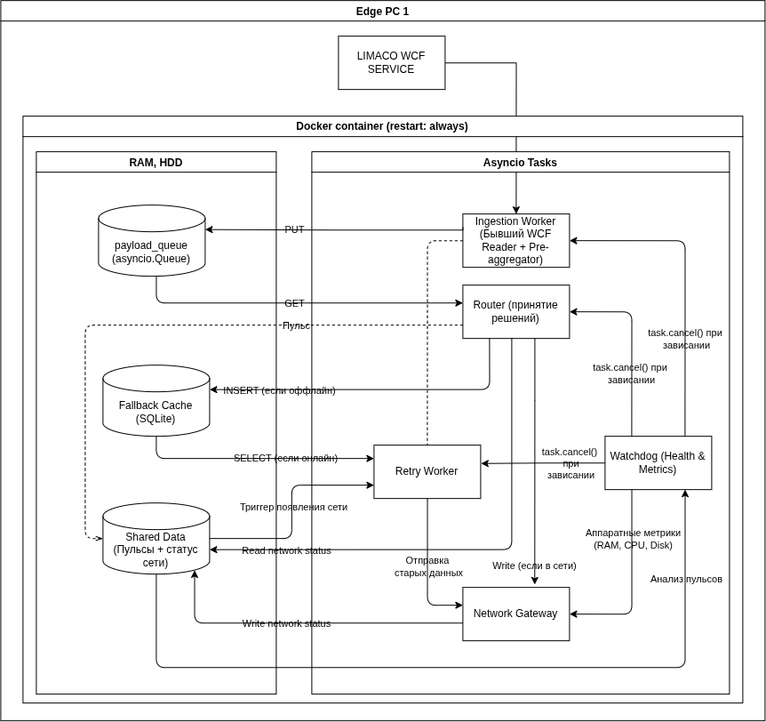

# EdgePC

Сервис для сбора телеметрии с уровнемера и отправки ее на Центральный Сервер

## Архитектура системы:

## Детали архитектуры:

Архитектура проектировалась согласно Clean Architecture с разделением ответственности между слоями:

> 📝 **TODO:** Описать архитектурные слои приложения (Entities, Services, Adapters, Workers, DTO и др.)

**Ingestion Worker**

Для получения сырых (raw) данных с OPC сервера Limaco клиент обращается к WCF интерфейсу через библиотеку zeep. Для сериализации и передачи данных через слои используется pydantic и паттерн DTO. 

Библиотека zeep позволяет общаться с WCF интерфейсом посредством методов, которые описаны в нем - данный функционал реализован в wcf_client. 

Для транспорта данных из zeep объектов в сущности был создан отдельный модуль dto.py, который описывает получаемые пакеты телеметрии и валидирует их через метод pydantic model_validate. Перевод в сущности осуществляет mapper для передачи телеметрии в слой адапера.

> 📝 **TODO:** Дописать архитектуру Ingestion

 
