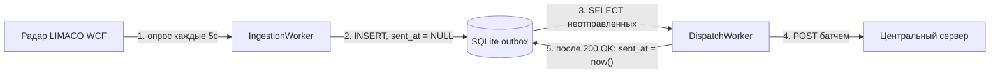
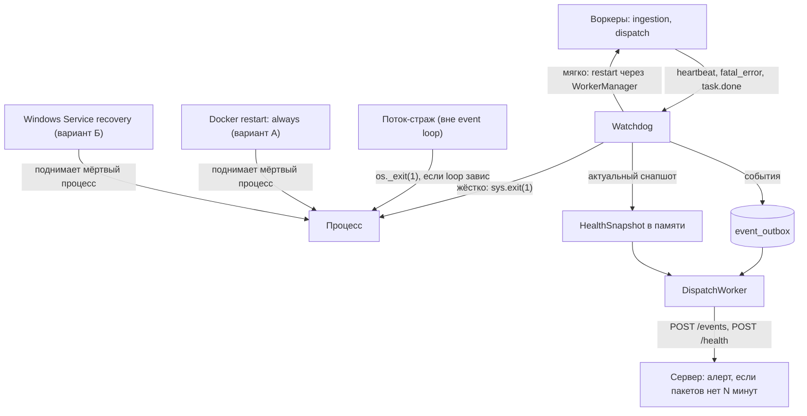
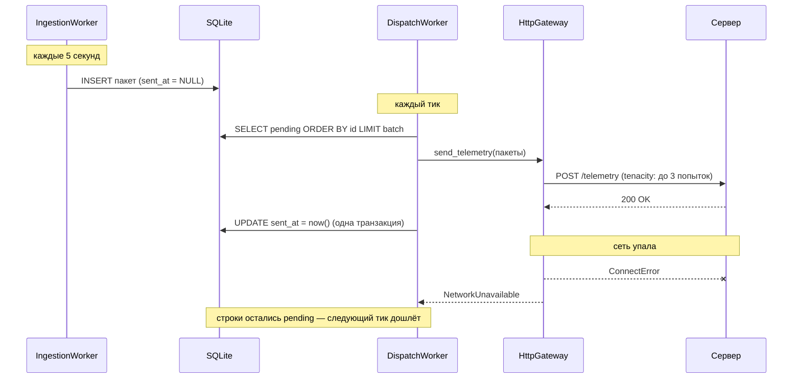
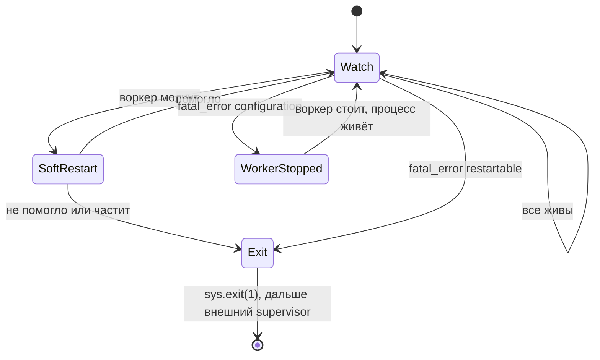

# EdgePC — архитектура сбора и доставки телеметрии

> Живой документ. Здесь: к какой архитектуре мы пришли, почему, из каких сервисов она состоит, как обрабатываются ошибки и что делать по шагам.

---

## 1. Главная идея в одном абзаце

Edge-устройство опрашивает радар (LIMACO WCF), **каждый пакет сразу пишет в локальную SQLite** и отдельным циклом отправляет на центральный сервер всё, что ещё не отправлено. Никаких очередей в памяти, никакого «определителя статуса сети», никакого отдельного механизма досылки: **неотправленные данные — это просто строки в таблице**, и один и тот же код отправляет и свежее, и накопившееся за сутки оффлайна.

Паттерн называется **outbox** — дословно «исходящие». Аналогия с почтовым клиентом точная: письмо сначала попадает в папку «Исходящие» на диске, отправлялка шлёт из неё, когда есть связь, отправленное помечается. Пропал интернет — письма просто лежат в «Исходящих», никакой отдельной логики «что делать при оффлайне» не существует. (Педантично: классический *transactional* outbox атомарно сохраняет бизнес-состояние плюс отдельное исходящее событие; у нас строка телеметрии сама и есть исходящая запись, так что точнее это называется store-and-forward с доставкой «как минимум один раз» через polling publisher. Механика и гарантии те же.)

Следствие: после краша, OOM, отключения питания или принудительного завершения все пакеты, чьи транзакции SQLite успешно закоммичены, останутся в outbox и будут повторно отправлены после рестарта. Пакет, который в момент сбоя только читался с радара, и измерения, которые не удалось опросить во время простоя ingestion, в эту гарантию не входят: если радар сам не хранит историю, восстановить их невозможно.

---

## 2. Как читать этот документ (маршрут входа)

1. Прочитать документ сверху вниз, держа открытой схему из раздела 4.
2. Открыть код и проследить путь одного пакета от старта до записи в БД: `bootstrap._build_worker_manager` → `IngestionWorker.start` → `IngestionService.collect_once` → `WCFRadarAdapter.read_packet` → `SqlAlchemyTelemetryRepository.save`. Это займёт около получаса и покажет на живом коде большинство идей документа: слои, порты, доменные ошибки.
3. Посмотреть `src/domain/exceptions.py` — докстринги объясняют семантику каждой ошибки.
4. Реализовать TODO (раздел 10) по порядку: сначала закрыть инфраструктурный gate шага 0, затем шаги 1, 1а, 2–4 механические, шаг 5 — где живёт суть. Если шаг 5 понятен — архитектура понята.
5. После любого рефакторинга проверять правило слоёв «domain и application не импортируют infrastructure» одной командой: `rg "^from src" src/domain src/application` выводит все импорты внутри этих слоёв; если в выводе встретилось `infrastructure` — правило нарушено, зависимость надо развернуть через порт.

### Мини-словарь (термины, которые дальше используются без пояснений)

- **Порт** — абстрактный класс в `src/domain/ports/`: контракт «что система умеет», без ответа «как». Пример: `RadarAdapter` с одним методом `read_packet()`.
- **Тик** — одна итерация цикла воркера: сделал работу → обновил heartbeat → поспал интервал.
- **Event loop** — цикл asyncio, который в одном потоке по очереди выполняет все корутины. Если кто-то заблокировал поток — замирают все разом.
- **Реализация порта (адаптер)** — конкретный класс в `src/infrastructure/`, выполняющий контракт. У одного порта их несколько: `WCFRadarAdapter` (боевая), `MockRadarAdapter` (для отладки).
- **Outbox** — таблица «исходящих»: доставляемые строки имеют `sent_at IS NULL AND quarantined_at IS NULL`, отправленные — заполненный `sent_at`, спорные — заполненный `quarantined_at`.
- **Pending** — строки, которые прямо сейчас ожидают отправки: `sent_at IS NULL AND quarantined_at IS NULL`. Карантинные строки не pending: они сохранены, но автоматически больше не отправляются.
- **Батч** — пачка пакетов, отправляемая одним HTTP-запросом (чтобы после суток оффлайна не слать 17 000 запросов по одному).
- **Идемпотентность** — свойство сервера: повторный приём того же пакета не создаёт дубль. Нужна, потому что повторы отправки неизбежны.
- **Backoff** — растущая пауза между повторами неудавшегося запроса: 1с → 2с → 4с → 8с, чтобы не долбить лежащий сервер.
- **Джиттер** — случайная добавка к этой паузе (например, ±50%). Без неё сто устройств, потерявших сервер одновременно, будут и повторять одновременно — и снова его завалят.
- **Heartbeat** — отметка времени «я жив», которую воркер обновляет каждый тик; по её свежести Watchdog отличает работающий воркер от зависшего.
- **Dead man's switch** — «кнопка мертвеца»: тревога срабатывает не по сигналу, а по его *отсутствию*. У нас: сервер алертит, если от бункера долго нет пакетов.
- **TTL / ретенция** — срок хранения и правила очистки старых данных.
- **WAL** — режим журнала SQLite, при котором читатели не мешают писателю и наоборот. Одновременные записи SQLite всё равно выполняет последовательно, поэтому при двух воркерах дополнительно нужен `busy_timeout`.
- **NAT** — роутер прячет устройства локальной сети за одним внешним адресом: изнутри наружу соединяться можно, снаружи внутрь — нельзя. Наш edge именно в таком положении.
- **SIGTERM** — Unix-сигнал ОС «завершись, пожалуйста». В варианте А его шлёт `docker stop`; в варианте Б Windows Service использует собственное событие остановки. Процесс, который обрабатывает соответствующий платформе сигнал, успевает завершиться корректно.
- **Graceful shutdown** — корректное завершение по такому сигналу: доработать текущий тик, закрыть БД, и только потом умереть.
- **Поток-страж** — наш маленький компонент: обычный поток ОС вне asyncio, который проверяет, что event loop отвечает, и убивает процесс, если тот завис. Подробно — разделы 5 и 9.
- **Health-снапшот** — отчёт «как устройство себя чувствует прямо сейчас» (состояние воркеров, глубина очереди, число карантинных, метрики железа). Отправляется свежим через `POST /health`, историю не хранит — в отличие от **событий** (рестарт, fatal_error, карантин), которые едут через `event_outbox`. Ограничение при остановке самого dispatch объяснено в разделе 9, контур 3.
- **DTO** (data transfer object) — класс под формат конкретного источника: «как радар отдаёт данные». Живёт только внутри адаптера.
- **ORM-модель** — класс под формат хранения: «как строка лежит в SQLite» (SQLAlchemy).
- **Инвариант** — правило, которое верно для сущности всегда: ровно 64 луча, `ts` с таймзоной. Нарушен — объект просто не создастся.

---

## 3. Как мы к этому пришли (эволюция)

Первоначальная схема (диаграмма v1):

```
Ingestion → payload_queue (RAM) → Router → [онлайн]  → Network Gateway
                                         → [оффлайн] → Fallback Cache (SQLite)
Fallback Cache → Retry Worker → Network Gateway (при появлении сети)
Shared Data: статус сети + пульсы
```

Проблемы, которые в ней нашли:

1. **payload_queue в RAM** — краш процесса теряет всё, что в очереди. Ради защиты от этого и затевался fallback, то есть схема противоречила собственной цели.
2. **Router с проверкой «сеть есть?»** — статус сети устаревает между проверкой и отправкой. Честная логика — «попробуй отправить», а не «спроси статус».
3. **Два пути кода** (онлайн/оффлайн) — оффлайн-путь выполняется редко, тестируется хуже всего, а нужен именно в аварию.
4. **Три источника правды** (очередь, кэш, Shared Data) — могут противоречить друг другу, гонки между Router/Retry/Shared Data.

Решение: писать в SQLite **всегда**, первым шагом. Тогда очередь не нужна (таблица и есть очередь, переживающая рестарт), Router не нужен (путь один), Retry Worker не нужен (досылка = обычная отправка), статус сети не нужен (есть pending-строки → шлём; не получилось → остались).

Цена: один `INSERT + COMMIT` на пакет и задержка доставки до одного тика диспетчера. При `synchronous=FULL` commit включает fsync, поэтому его фактическая длительность зависит от диска и прослоек виртуализации и измеряется на целевом томе, а не оценивается заранее в микросекундах. Для телеметрии раз в 5 секунд ожидаемая цена мала, но это должен подтвердить benchmark на конечном устройстве.

### Сколько это экономит времени разработки — честная оценка

Разработка состоит из двух неравных частей, и экономия живёт только во второй:

1. **Написать код** — здесь схемы почти равны. Очередь, Router и Retry Worker — несложные компоненты, каждый пишется за вечер; старая схема потребовала бы на пару дней больше просто потому, что частей шесть, а не три. Если бы работа заканчивалась на «запустилось на столе при хорошей сети» — переделывать архитектуру не стоило бы.
2. **Довести до «уверенно работает, включая оффлайн и краши»** — отладка и тестирование. Именно эта часть занимает большую часть календаря, и именно здесь старая схема дорожает в разы: в ней баги — это гонки между шестью компонентами, а в новой — логика одной таблицы.

Поэтому дальше два итога не противоречат друг другу: «написать — одинаково» про пункт 1, «в 2 раза быстрее» — про сумму 1 + 2.

Оценка для одного разработчика без готовых наработок под такую схему, от текущего состояния кода до «уверенно работает, включая оффлайн-сценарии»:

**Старая схема (очередь + Router + Retry Worker + статус сети): ~5–7 недель.**

- Написать компоненты: ~2 недели. Шесть взаимодействующих частей: очередь, Router, определитель статуса сети, запись в fallback, Retry Worker, Gateway.
- Отладить взаимодействия: ~2–3 недели, и это оптимистично. Здесь живут худшие баги: Router проверил «сеть есть», сеть упала, пакет потерялся между очередью и Gateway; Retry Worker и Router одновременно шлют одни данные — дубли; статус сети «моргает» — пакеты мечутся между двумя путями; краш при непустой очереди — сколько потеряли, неизвестно. Каждый такой баг гонка: воспроизводится раз в N часов, в тестах не ловится, в логах выглядит как «иногда чего-то не хватает».
- Протестировать оффлайн-путь: ~1–2 недели. Два пути кода — двойной набор сценариев, причём аварийный путь надо искусственно провоцировать (рвать сеть в нужный момент между проверкой и отправкой — попробуй ещё попади).

**Новая схема (outbox): ~2–3 недели.**

- Шаги 1–7 TODO (колонка, репозиторий, DispatchService, воркер, сборка): ~1 неделя. Сердце — `dispatch_once` — 8 строк, и он уже написан в этом документе.
- Отладка взаимодействий: дни, а не недели, потому что взаимодействие одно: два воркера через одну таблицу. Гонок между «путями» нет — путь один. Состояние системы видно двумя простыми счётчиками: доставляемые (`sent_at IS NULL AND quarantined_at IS NULL`) и карантинные (`quarantined_at IS NOT NULL`), а не размазано по очереди в RAM, кэшу и Shared Data.
- Тестирование оффлайна: почти бесплатно. Оффлайн — не отдельный путь, а тот же код с непустой очередью: mock-гейтвей с fail rate 0.5 прогоняет «аварийный» сценарий каждые несколько секунд прямо на столе.

Ещё две-три недели в обеих схемах уходят одинаково — Watchdog, страж, SIGTERM, договорённости с сервером: это не зависит от выбора схемы доставки.

Итого по компоненту доставки: **примерно в 2 раза быстрее до продакшена** (2–3 недели против 5–7). Но главная экономия даже не тут, а в сопровождении: баг в outbox-схеме — это «посмотри одну таблицу и лог одного воркера», баг в старой — «восстанови по логам, в каком из трёх источников правды и на каком из двух путей потерялся пакет», причём удалённо, на устройстве за NAT, куда нельзя подключиться. Один такой инцидент на проде стоит недели.

Оговорка, чтобы оценка осталась честной: цифры — для этого проекта и этого контекста (один разработчик, без готовых наработок под распределённую доставку, устройства недоступны снаружи). Команда с такими наработками сократила бы обе оценки, но соотношение «в разы дороже отлаживать гонки, чем таблицу» осталось бы.

---

## 4. Схемы: поток данных и надзор — отдельно

Две независимые картинки, потому что это две независимые заботы: первая — «как пакет доезжает до сервера», вторая — «кто за кем следит».

### Поток данных (читать слева направо)



Если шаг 4 не удался — шаг 5 не происходит, строки остаются в таблице, и следующий тик начнёт снова с шага 3. Это весь механизм устойчивости к оффлайну.

### Цепочка надзора (каждый уровень проще предыдущего)



Принцип: каждый следующий уровень тупее и надёжнее предыдущего. Воркеры сложные, Watchdog — простой цикл, поток-страж — три строчки, внешний supervisor — чужой отлаженный код, серверный алерт — вообще не код edge-устройства. В варианте А supervisor — Docker `restart: always`, в варианте Б — recovery-политика Windows Service (варианты описаны в разделе 8). Чем выше поднимается отказ, тем примитивнее механизм, который его ловит.

---

## 5. Сервисы: что делает каждый и зачем он нужен

### IngestionWorker + IngestionService — есть, работает

- **Имя:** ingestion (англ. «приём, заглатывание») — стандартный термин для «затащить данные в систему». Этот сервис — вход: всё, что попадает в систему, попадает через него.
- **Что делает:** раз в 5 секунд читает пакет с радара через порт `RadarAdapter` и сохраняет в SQLite через порт `TelemetryRepository`. (Статус «не отправлено» появится вместе с колонкой `sent_at` в шаге 1 TODO — сейчас пакеты просто сохраняются.)
- **Чего НЕ делает:** не знает про сеть, сервер и отправку. Радар лежит — воркер ретраит тиками и останавливается после N подряд сбоев.
- **Почему так:** сбор не должен зависеть от состояния канала — это весь смысл буферизации на диске.

### DispatchWorker + DispatchService — новый, главный из новых

- **Имя:** dispatch (англ. «отправка, диспетчеризация») — как диспетчер на складе: смотрит, какие грузы накопились (pending-строки), собирает партию (батч), отправляет, отмечает отгруженное в журнале (`sent_at`). Он не производит данные и не возит их сам — он *распоряжается отправкой*. Имя «Sender» было бы уже (сервис ещё и помечает, и порядок соблюдает), «Router» — враньё (маршрут один).
- **Что делает:** раз в N секунд берёт из БД пачку pending-строк по порядку вставки (`ORDER BY id`), отправляет через порт `NetworkGateway` (о нём — следующий подраздел), по подтверждению помечает `sent_at = now()` одной транзакцией. Удалением занимается ретенция (см. раздел 8), не отправка.
- **Заменяет собой** Router, Retry Worker и «отправку из Gateway» из старой схемы — «отправить всё неотправленное» покрывает и свежие данные, и досылку после оффлайна.
- **Оффлайн для него — штатный режим:** отправка не удалась → строки остались pending → следующий тик попробует снова.

### NetworkGateway (порт) и его реализации — новые

Последовательность здесь такая же, как у радара: сначала контракт в domain, потом взаимозаменяемые реализации в infrastructure.

- **Имя:** gateway (англ. «шлюз, ворота») — единственная дверь, через которую данные покидают устройство. Всё сетевое (адреса, токены, повторы, HTTP-коды) живёт за этой дверью; остальной код знает только «отдай пачку наружу».
- **Порт `NetworkGateway`** (`src/domain/ports/network_gateway.py`) — три параллельных метода: `send_telemetry`, `send_events`, `send_health`.

```python
class NetworkGateway(ABC):
    @abstractmethod
    async def send_telemetry(self, packets: list[TelemetryPacket]) -> None:
        """Доставить пачку телеметрии.

        Ошибки — строго доменные, по классам из раздела 8:
        NetworkUnavailable  — временная проблема, повторить позже;
        DispatchRejected    — сервер отверг данные (422), ретраи бесполезны;
        DispatchMisconfigured — токен/контракт (400/401/403), нужен человек.
        """

    @abstractmethod
    async def send_events(self, events: list[EdgeEvent]) -> None: ...

    @abstractmethod
    async def send_health(self, snapshot: HealthSnapshot) -> None: ...
```

  `DispatchService` зависит только от этого класса и не знает, какая реализация подставлена. `send_events` (`POST /events`) и `send_health` (`POST /health`) — те же классы ошибок, что у телеметрии; см. раздел 9, контур 3.
- **`MockNetworkGateway`** (infrastructure) — реализация для разработки: «отправляет» в лог и падает с заданной вероятностью, чтобы прогонять досылку без реального сервера. По образцу mock-радара.
- **`HttpGateway`** (infrastructure) — боевая реализация: HTTP POST батча на сервер. Внутри tenacity делает 2–3 повтора с растущей паузой и джиттером (см. словарь в разделе 2: пауза до 1с, плюс случайная добавка, чтобы сто бункеров не повторяли синхронно). Обрыв/таймаут/5xx/429 переводит в `NetworkUnavailable`, 422 — в `DispatchRejected`, 400/401/403 — в `DispatchMisconfigured`: наружу выходят только эти доменные классы, а не httpx-исключения.
- **Edge не знает, что на сервере.** Сегодня сервер пишет в Postgres, завтра поставит Kafka за тем же HTTP-эндпоинтом — код edge не меняется.

### Watchdog — новый, пишется последним

- **Имя:** watchdog (англ. «сторожевой пёс») — устоявшийся термин из embedded-систем: компонент, который сам ничего полезного не делает, а только следит, что остальные живы, и поднимает тревогу.
- **Что делает:** наблюдает за воркерами по трём агрегированным сигналам (раздел 9, контур 2), принимает решения об эскалации; пишет события (рестарт, fatal_error) в outbox событий и собирает health-снапшот, который Dispatch отправляет свежим каждый тик (раздел 9, контур 3).
- **Чего НЕ делает:** не видит отдельные ошибки тиков (это работа воркеров) и не выполняет механику рестартов (это работа WorkerManager и внешнего supervisor).

### Поток-страж event loop — новый, самый маленький

- **Что делает:** обычный `threading.Thread` вне asyncio; проверяет, что event loop отвечает (метка времени через `call_soon_threadsafe`), и делает `os._exit(1)`, если loop завис. Единственный компонент, который переживает зависание всего asyncio-мира — его планирует ОС, а не event loop.
- **Чего НЕ делает:** ничего больше. Три строчки логики, ноль зависимостей — именно поэтому ему можно доверять, когда всё остальное встало. Подробности — раздел 9, «А если завис сам Watchdog?».

### WorkerManager — есть

- Запускает всех воркеров, умеет `stop_all()` и `health_report()`. Добавится: `restart(name)` — отменить задачу воркера и создать заново (механика для решений Watchdog). Принимает любой объект с протоколом `Worker` — новые воркеры добавляются одной строкой в bootstrap.

---

## 6. Модели данных: почему их три вида

Правило чистой архитектуры: доменная модель описывает «что такое телеметрия», ORM-модель — «как она лежит в SQLite», DTO — «в каком виде её отдаёт конкретный источник». Меняются они по разным причинам, поэтому это разные классы.

### Доменные (`src/domain`) — pydantic, frozen, с инвариантами

- **`TelemetryPacket`** — event_id, ts, avg_level, mass, volume, beams, source_state.
  Инварианты: `ts` обязан иметь таймзону; ровно 64 луча; масса/объём/уровень могут быть `None` (источник не прислал значение).
  `event_id` — UUID, генерируется при создании пакета (`default_factory=uuid4`): постоянная идентичность измерения, по которой сервер отличает повтор отправки от нового пакета. В отличие от `bunker_id` (контекст отправки, живёт в гейтвее) идентичность — свойство самого измерения, поэтому ей место в сущности.
- **`Beam`** — height, raw_status, status.
  Инварианты: height без NaN/Inf (отрицательная — можно, это ниже опорной точки); неизменяемый.
- **`Measurement`** (тип) — `float`, конечный, ≥ 0. Общий тип для физических величин.

Инварианты лежат в domain (а не в DTO), чтобы срабатывать для **любого** источника — WCF, mock, будущий Modbus.

### DTO (`src/infrastructure/radar/wcf`) — причуды формата источника

`WCFVesselDTO`, `WCFBeamDTO`, `WCFDataDTO` — разворачивают zeep-структуры, парсят строковый ответ `GetData`, отбраковывают NaN. Живут только внутри WCF-адаптера, наружу не выходят.

### ORM (`src/infrastructure/database/models`) — SQLAlchemy

`TelemetryPacketModel`: колонки пакета + `id`, `beams` как JSON, индекс по `ts`.
**Добавится:** `sent_at: datetime | None` с индексом — `NULL` означает «не отправлено».

### StoredPacket — добавится в `domain/ports`

Frozen-датакласс `(id, packet)` — то, что возвращает `get_pending`: доменный пакет плюс ключ хранения, чтобы после отправки пометить `sent_at` именно у этих строк. `id` в саму сущность не добавляем — это деталь хранения. Подробный разбор с кодом — TODO, шаг 2.

---

## 7. Как сервис понимает, что нет интернета

Короткий ответ: **никак не проверяет заранее — узнаёт, попробовав отправить.** Это осознанное решение, а не пробел:

- Любая предварительная проверка (ping, запрос статуса, флаг в Shared Data) устаревает в момент завершения: сеть может упасть между проверкой и отправкой. Единственный честный тест канала — сама отправка.
- Попытка отправки и есть проверка: `HttpGateway` делает POST; не получилось → кидает `NetworkUnavailable` → Dispatch ничего не помечает → строки остались pending. Получилось → канал, очевидно, есть.
- Поэтому статус сети **вычисляется, а не хранится**: глубина очереди (`COUNT(*) WHERE sent_at IS NULL AND quarantined_at IS NULL`) растёт → канал лежит (или сервер); тает → всё работает. Карантин считается отдельно. Watchdog кладёт обе метрики в health-снапшот.

Что при этом различимо, если захочется деталей в логах: httpx отдаёт разные исключения для «нет сети вообще» (`ConnectError`, DNS-ошибки), «сервер не отвечает» (`ConnectTimeout`, `ReadTimeout`) и «сервер отвечает, но плохо» (HTTP 5xx). Для поведения edge разницы нет — во всех случаях строки остаются pending, — но в лог и health-снапшот стоит писать тип ошибки: оператору это скажет, чинить связь или сервер.

Состояние **источника** (радара) — отдельная вещь: enum `SourceState` (`HEALTHY` / `WCF_DOWN` / `WCF_RECOVERED`) едет внутри самого пакета, чтобы сервер отличал «радар лежал» от «связи не было». Честная оговорка о текущем коде: сейчас маппер всегда ставит `HEALTHY` — вычисление реального состояния предстоит сделать (иначе enum бесполезен).

---

## 8. Отправка на центральный сервер: полный цикл

### Топология: у edge нет публичного IP — соединение всегда исходящее

Edge PC стоит за NAT (LTE-модем / роутер объекта), публичного адреса у него нет. Значит, **все соединения инициирует edge, сервер не может достучаться до устройства в принципе**. Это не ограничение, которое надо обходить, — это упрощение, вокруг которого архитектура уже построена: edge только «выносит» данные наружу.

**Что это означает для Edge PC:**

- нужен только **исходящий** HTTPS (порт 443) до публичного адреса/домена сервера — работает через любой NAT без настройки проброса портов;
- на устройстве не слушается ни один входящий порт — нечего атаковать и нечего настраивать на роутере объекта;
- адрес сервера — конфигурация: `DISPATCH__SERVER_URL=https://telemetry.example.com` в `.env`;
- аутентификация «кто ты такой» — токен бункера в заголовке запроса (`Authorization: Bearer ...`), выдаётся при установке устройства, лежит в `.env`;
- TLS обязателен — данные идут через публичный интернет.

**Что это означает для центрального сервера:**

- публичный IP/домен, TLS-сертификат и три явных endpoint: `POST /telemetry` для пакетов, `POST /events` для надёжных событий, `POST /health` для актуального снапшота;
- проверка токена, дедупликация по `bunker_id + event_id`, атомарный приём батча;
- `last_seen` и dead man's switch — **единственный** способ узнать о проблеме на объекте: сервер не может пингануть edge, опросить его состояние или «попросить дослать». Всё, что серверу нужно знать, edge должен принести сам — поэтому health-снапшоты и едут с устройства, а не запрашиваются с сервера.

Если когда-нибудь понадобится управление устройством с сервера (сменить интервал, форсировать что-то) — при такой топологии это делается только «попутно»: edge спрашивает сам, например сервер кладёт команды в ответ на `POST /health`. Либо VPN (WireGuard/Tailscale) — но это отдельное решение с отдельными рисками, сейчас не нужно.

### Цикл отправки



Договорённости с сервером (важно, из первоисточников):

- **Идемпотентность обязательна.** Outbox-паттерн гарантирует доставку «хотя бы раз», а не «ровно раз»: Dispatch может отправить пакет, упасть до пометки `sent_at` и после рестарта отправить его снова. Сервер обязан дедуплицировать — по ключу `bunker_id + event_id` (это наш аналог idempotency key у Stripe).
- **`event_id` — а не `ts` — потому что часам верить нельзя.** Каждый пакет при создании получает случайный UUID (`event_id`). Ключ `bunker_id + ts` выглядел бы естественнее, но у него скрытая дыра: NTP-коррекция может сдвинуть часы назад, и два *разных* пакета получат одинаковый `ts` — сервер молча выбросит один как «дубль». UUID генерируется без участия часов, поэтому дедупликация от них не зависит; `ts` остаётся тем, чем должен быть, — временем измерения для графиков и аналитики.
- **`bunker_id` добавляет гейтвей, не сущность.** В `TelemetryPacket` его нет и не должно быть — устройство одно, это контекст отправки, а не свойство измерения. `HttpGateway` получает `bunker_id` из настроек при сборке и вставляет в тело/заголовок запроса. (А `event_id` — в сущности: это идентичность самого измерения, она нужна при любом способе доставки.)
- **Батч подтверждается целиком, а виновника ищет edge.** Либо 200 — и весь батч помечается отправленным, либо ошибка — и не помечается ничего; дубли при повторе гасит серверная дедупликация. Контракт остаётся простым, но у атомарности есть следствие: получив 422 на батч, edge не знает, *какой именно* пакет сервер счёл некорректным. Поэтому изоляция — на нашей стороне: после отказа батча как «ошибки данных» Dispatch пересылает те же пакеты **по одному** (это тот же `send_telemetry` со списком из одного элемента); прошедшие помечаются отправленными, отклонённые персонально копят `attempts` и уходят в карантин. Медленный путь включается только при 422 — в штатной жизни его нет.
- **Не всякая ошибка сервера — «повторить позже».** Ответы делятся на три класса, и путать их опасно: **временные** (таймаут, обрыв, 5xx, 429) → `NetworkUnavailable`, строки остаются pending, повтор следующим тиком — единственный класс, где ретраи уместны; **ошибка данных** (422 — сервер понял запрос, но конкретные пакеты считает некорректными) → повторять бесполезно, тот же пакет получит тот же отказ, и без отдельной обработки он навсегда заблокирует очередь (см. карантин ниже); **ошибка конфигурации** (401/403 — плохой токен; 400 — сервер не понял сам запрос, то есть формат тела разъехался с контрактом) → фатально для dispatch, как `RadarSourceMisconfigured` для радара: само не пройдёт, нужен человек. Важно, что 400 — не в классе «данных»: изоляция по одному ему не поможет (отклонится любой запрос) и лишь отправила бы в карантин здоровые пакеты. Вечный ретрай 401 маскировал бы ошибку конфигурации под «сети нет».
- **Карантин отравленных пакетов.** Пакет, персонально отклонённый сервером (после изоляции по одному) `quarantine_after_attempts` раз (по умолчанию 3), помечается карантином и исключается из `get_pending` — очередь продолжает ехать, а число карантинных строк уезжает в health-снапшот для разбора человеком. Не удаляем: это данные, просто спорные.
- **Часы на edge всё равно должны быть верными.** После перехода на `event_id` дедупликация от часов уже не зависит, но `ts` остаётся смыслом данных: кривые часы = кривые графики и ложные «дыры» в телеметрии. На подтверждённом Windows-хосте время синхронизирует Windows Time (`w32time`); при отдельном Linux-хосте — chrony/systemd-timesyncd. В health-снапшот кладём текущее время процесса edge — сервер сравнит со своим и заметит дрейф.
- **Джиттер в ретраях.** Если сервер лежал и поднялся, все бункеры начнут досылать одновременно и могут его же и положить — это называется thundering herd, «топочущее стадо». Поэтому в tenacity — не чистая экспонента (1с → 2с → 4с у всех одинаково), а `wait_random_exponential` (у каждого своя случайная пауза около этих значений); интервал тика Dispatch тоже стоит слегка рандомизировать.
- **Батчи ограничены** (100–500 пакетов): после суток оффлайна в outbox ~17 000 строк, слать одним запросом нельзя.

**Ретенция — принятое решение** (одно, чтобы не разъезжалось по коду):

- отправленные строки **помечаются** `sent_at = now()`, а удаляет их ретенция — `purge` чистит отправленные старше TTL (например, 7 дней): бесплатная локальная история для отладки;
- **pending не удаляется автоматически никогда** — это недоставленные данные. Защита от переполнения диска — ступенчатая явная политика, с честной оговоркой: если диск заполняется, то почти наверняка **из-за оффлайна**, а значит, алерт с устройства до сервера в этот момент не доедет физически. Поэтому уровни такие: (1) о самом оффлайне оператор узнаёт с первых минут — по dead man's switch на сервере, и недельный запас диска (пакет ~2–3 КБ, сутки — ~40 МБ) — это время на починку связи, а не на «услышать алерт»; (2) порог заполнения (например, 80%) едет в health-снапшоте — сработает в сценариях, когда связь есть, а диск ест что-то другое (логи, чужой софт); (3) жёсткий резерв: при падении свободного места ниже минимума (например, 200 МБ) ingestion перестаёт вставлять новые пакеты **сам**, не дожидаясь отказов SQLite, — система деградирует к потере новых данных, всё накопленное остаётся целым и уедет после восстановления. Тихого удаления старых pending нет ни на какой ступени.

Два уровня ретраев с разными ролями:

- **Короткий (секунды)** — tenacity внутри HttpGateway: моргнула сеть, таймаут одного запроса. 2–3 попытки — и сдаёмся.
- **Длинный (часы/сутки)** — тики DispatchWorker поверх outbox: сервер лежит, кабель выдернут. Строки ждут в БД сколько нужно.

### Топология развёртывания: Windows-хост + LIMACO WCF + где запускать EdgePC

Что здесь **подтверждено**, а что — выбор. Подтверждено одно: хост — Windows, потому что на нём работает ПО LIMACO. Наш код Windows не требует: WCF для клиента — обычный SOAP поверх HTTP, zeep ходит по нему с любой ОС. Где запускать сам EdgePC — **решение, которое надо явно принять** (см. критерий ниже); варианты:

- **Вариант А — Linux-контейнер в Docker Desktop (предпочтительный, если пройдёт gate шага 0).** Плюсы: сервис ведёт себя как на обычном Linux — SIGTERM и `loop.add_signal_handler` (шаг 10) работают штатно, `restart: always` даёт супервизию процесса, окружение воспроизводимо (один образ на все устройства), SQLite живёт на ext4 в named volume с честными блокировками. Минусы: лишний слой (VM Docker Desktop) между сервисом и железом; автозапуск Docker Desktop **без входа пользователя не гарантирован — это надо проверить на целевом ПК до принятия решения**, у Docker Desktop есть лицензионные условия (бесплатен не для всех организаций — проверить применимость).
- **Вариант Б — нативный Windows-процесс** (Python на хосте, автозапуск как служба Windows через NSSM или Task Scheduler). Плюсы: нет Docker-слоя вообще, автозапуск службы Windows — штатный и надёжный, LIMACO доступен просто по `localhost`. Минусы: `loop.add_signal_handler` на Windows не работает (шаг 10 придётся решать иначе — обработкой `CTRL_BREAK_EVENT`/событий службы), супервизию `restart: always` заменяет recovery-политика службы, окружение (Python, зависимости) ставится и обновляется руками на каждом устройстве.
- **Вариант В — Windows-контейнер: не рекомендуется.** Худшее из обоих миров: гигантские базовые образы, `docker stop` не доставляет обычный Unix SIGTERM, экосистема заметно слабее — платим цену контейнеров, не получая их главных выгод.

**Критерий выбора простой:** если на целевом ПК подтверждается, что Docker Desktop стартует после перезагрузки без входа пользователя, и лицензия применима — вариант А; не подтверждается — вариант Б (и тогда шаг 10 и супервизия процесса переделываются под механизмы служб Windows). Эта проверка вынесена в шаг 0 TODO и выполняется **до изменений схемы и кода**.

Дальше — следствия для варианта А (каждое стоит незаметных часов отладки, если о нём не знать заранее); при выборе варианта Б пункты про контейнер отпадают, но появляются свои — сигналы, служба, пути:

```
Windows-хост (ПК у бункера)
├── ПО LIMACO + WCF-служба          ← слушает HTTP-порт (например, 8001)
└── Docker Desktop (Linux VM)
    └── контейнер EdgePC             ← наш сервис, обычный Linux внутри
        └── зовёт WCF через http://host.docker.internal:8001/...
```

- **`localhost` внутри контейнера — это сам контейнер,** а не Windows-хост. Текущий `.env.example` (`WCF__WSDL_URL=http://localhost:8001/...`) на реальном устройстве работать не будет — нужен `host.docker.internal` (специальное имя, которым Docker Desktop указывает на хост).
- **WCF-служба должна слушать не только loopback.** Если LIMACO поднимает endpoint на `localhost`, соединение из контейнера (для хоста оно выглядит как приходящее с виртуального сетевого интерфейса) не пройдёт — служба должна слушать `0.0.0.0` или хотя бы интерфейс Docker. Плюс файрвол Windows должен пропускать этот порт с виртуальной сети Docker.
- **WSDL не должен возвращать endpoint с `localhost`.** Коварная деталь WCF: в опубликованном WSDL прописан адрес самой службы, и zeep пойдёт по нему, даже если WSDL скачал по правильному адресу. Если внутри WSDL написано `localhost` — все вызовы после чтения WSDL молча уйдут «в никуда» внутри контейнера. Лечится либо конфигурацией базового адреса службы, либо на нашей стороне — явным заданием адреса сервиса в zeep, минуя адрес из WSDL.
- **Сигналы работают, потому что контейнер — Linux.** `loop.add_signal_handler` и SIGTERM от `docker stop` (шаг 10) в Linux-контейнере на Windows-хосте ведут себя как на обычном Linux. Это одно из главных преимуществ варианта А: при варианте Б весь механизм graceful shutdown из шага 10 пришлось бы переделывать под Windows.
- **Время: на хосте — w32time, не chrony.** chrony/systemd-timesyncd (шаг 9а) — это про Linux-серверы; на Windows-хосте время синхронизирует служба Windows Time (`w32tm /query /status` для проверки). Контейнер наследует часы VM Docker Desktop, у которой известна болячка: **после сна/гибернации хоста часы VM могут отставать** — на устройстве, работающем 24/7, сон должен быть выключен, а сверка времени в health-снапшоте (шаг 9а) поймает дрейф, если он всё же случится.
- **SQLite — только в named volume.** БД, WAL и SHM-файлы нельзя оставлять в слое контейнера (пропадут при пересоздании) и нельзя класть на сетевую шару или bind mount к NTFS (файловые блокировки SQLite через прослойку Docker Desktop ненадёжны). Правильно: именованный Docker-том (`volumes: telemetry-data:/app/data`) — он живёт на ext4 внутри Linux VM, где блокировки честные.
- **`synchronous=FULL` тестировать на реальном томе.** Между SQLite и физическим диском теперь два слоя (Linux VM + NTFS), и честность fsync надо проверять именно там: тест с выдёргиванием питания (шаг 1) выполняется на собранном устройстве, а не на ноутбуке разработчика.
- **Автозапуск после перезагрузки Windows — открытый вопрос, он и решает выбор варианта.** `restart: always` поднимает контейнер, только когда сам Docker уже запущен, а Docker Desktop по умолчанию стартует при входе пользователя. Устройство у бункера перезагрузится после отключения света — и никто не войдёт в систему. Утверждать, что headless-автозапуск Docker Desktop настраивается (автовход, планировщик, служба), заранее нельзя — **это проверяется на целевом ПК до принятия варианта А**; не получилось надёжно — берём вариант Б.

Архитектуру всё это не меняет — outbox, воркеры и порты одинаковы на любой ОС. Шаг 0 фиксирует вариант, шаг 14 проверяет готовый deployment, а механика шага 10 реализуется под выбранную платформу.

---

## 9. Ошибки: три контура

Ошибки живут в трёх независимых контурах. Путаница возникает, когда их смешивают, поэтому разводим явно.

### Контур 1 — обработка в момент возникновения (внутри тика воркера)

Что бы ни сломалось в глубине (DTO не распарсился, zeep кинул таймаут, SQLite занята) — исключение поднимается по стеку вызовов **внутри текущего тика**: адаптер/репозиторий переводит его в доменное, воркер ловит и реагирует немедленно. Watchdog в этом контуре не участвует вообще — ошибка обработана за миллисекунды до того, как кто-либо снаружи мог бы её заметить.

> [!NOTE]
> **Словарь доменных ошибок и реакция воркера**
> - **`RadarSourceUnavailable`** — радар временно недоступен → лог warning, +1 к счётчику сбоев, следующий тик.
> - **`RadarSourceMisconfigured`** — конфигурация неверна → ingestion ставит нерестартуемый `fatal_error` и останавливается, но процесс и dispatch остаются живы: автоматический рестарт поднимет тот же контейнер/службу с той же конфигурацией и не поможет.
> - **`RadarDataInvalid`** — конкретный пакет мусорный (NaN, не 64 луча) → лог, пропуск тика, сбоем НЕ считается.
> - **`TelemetryStorageError`** — не записалось в SQLite → лог error, +1 к счётчику.
> - **`NetworkUnavailable`** (добавится) — временная сетевая проблема (обрыв, таймаут, 5xx, 429) → для Dispatch штатно: лог, ждать следующего тика.
> - **`DispatchRejected`** (добавится) — сервер отвечает 422: конкретные пакеты считает некорректными → ретраи бесполезны; Dispatch изолирует виновника пересылкой по одному, персонально отклонённые уходят в карантин (раздел 8).
> - **`DispatchMisconfigured`** (добавится) — сервер отвечает 401/403 (плохой токен) или 400 (не понял сам запрос — контракт разъехался) → dispatch-воркер ставит `fatal_error` и останавливается, но **процесс живёт**: ingestion продолжает копить данные в outbox (в этом весь смысл буфера), о проблеме сервер узнает по тишине (dead man's switch). Убивать процесс нельзя — внешний supervisor поднимет его с тем же плохим токеном, получится бесконечный цикл рестартов, который вдобавок прибьёт работающий сбор.

Итог каждого тика воркер записывает в своё состояние: `_consecutive_failures`, `_last_heartbeat`, `_fatal_error`. `fatal_error` — не просто строка, а структура как минимум с причиной и признаком `restartable`; иначе Watchdog не сможет отличить зависшую runtime-задачу от конфигурации, которую бессмысленно перезапускать. Это состояние — интерфейс между контуром 1 и контуром 2.

### Контур 2 — надзор (Watchdog): видит состояния, а не ошибки

Ответ на вопрос «как Watchdog увидит ошибку в DTO?» — **никак, и это правильно**. Отдельные ошибки — не его уровень. Он периодически (своим тиком, других механизмов и не нужно — всё в одном процессе, состояние воркеров доступно напрямую) читает три агрегированных сигнала:

1. `worker.is_alive()` — heartbeat обновлялся недавно → воркер крутится (пусть даже все тики неудачные — он жив и сам справляется);
2. `worker.fatal_error` — воркер сам признал, что не может продолжать;
3. `task.done()` — задача воркера завершилась, хотя не должна была (из цикла вылетело неперехваченное исключение).

Кто что **делает** (решение и механика разделены):

- **Watchdog решает** — по таблице, без интеллекта.
- **WorkerManager выполняет** мягкие меры: `restart(name)` = cancel задачи + пересоздание воркера.
- **Watchdog выполняет** жёсткую меру сам: `sys.exit(1)` — это последний код, который выполняется внутри процесса.
- **Внешний supervisor выполняет** рестарт процесса: Docker с `restart: always` в варианте А или Windows Service recovery в варианте Б. Внутри процесса полный рестарт не делает никто — изнутри это невозможно и не нужно.



- «воркер молчит» = heartbeat старше `max_silence` или `task.done()` без fatal_error;
- «помогло» = после `restart(name)` heartbeat снова обновляется, и рестартов < K за окно (например, 3 за 10 минут);
- «не помогло или частит» = cancel не завершился за 10с (задача застряла в блокирующем вызове) или > K рестартов за окно — проблема системная, мягкие меры не работают.

Переход `fatal_error → Exit` разрешён только для runtime-отказа, который действительно может исчезнуть после пересоздания процесса (например, зависшая I/O-граница или повторно падающая задача). Ошибки конфигурации — и `RadarSourceMisconfigured`, и `DispatchMisconfigured` — нерестартуемые: Docker restart поднимает тот же контейнер с тем же environment, а Windows Service — тот же процесс с тем же конфигом. Соответствующий воркер останавливается (`WorkerStopped`), остальные продолжают работу: при ошибке радара dispatch доставляет health/fatal-событие, при ошибке dispatch ingestion копит в outbox, а немедленную тревогу даёт dead man's switch. После ручного исправления конфигурации оператор делает controlled restart/recreate.

### А если завис сам Watchdog?

Честный разбор. У «зависшего Watchdog» есть два принципиально разных сценария:

**Сценарий А — завис только Watchdog, event loop жив.** Маловероятен по построению: Watchdog должен быть тривиальным циклом — читает поля объектов-воркеров (без I/O), пишет события в локальную SQLite и обновляет health-снапшот в памяти, спит. Ни сети, ни блокирующих вызовов в его тике нет, зависать не на чем. Это правило конструкции: **в тик Watchdog нельзя добавлять сетевые вызовы** — всей отправкой занимается Dispatch.

**Сценарий Б — встал весь event loop** (кто-то заблокировал поток: тяжёлый синхронный вызов мимо `to_thread`, бесконечный цикл в корутине). Тогда замирает всё сразу: и воркеры, и Watchdog, и его таблица решений. Изнутри asyncio это не обнаружит никто — код просто не выполняется. Для этого в цепочке надзора есть **поток-страж** (см. схему в разделе 4): обычный `threading.Thread`, живущий вне event loop. Механика в три строчки: страж периодически просит loop обновить метку времени через `loop.call_soon_threadsafe(...)`; сам поток (его планирует ОС, а не asyncio — зависание loop его не трогает) проверяет свежесть метки; метка протухла дольше порога → `os._exit(1)`. Именно `os._exit`, а не `sys.exit`: нужно убить процесс немедленно, без раскрутки исключений через тот самый повисший loop. Дальше внешний supervisor (Docker в варианте А, Windows Service recovery в варианте Б) поднимает процесс, outbox сохраняет записанные данные.

**Последний рубеж — центральный сервер (dead man's switch).** Если от бункера нет ни телеметрии, ни health-снапшотов дольше порога (например, 10 минут) — алерт оператору. Этот уровень ловит то, что не может поймать ничто на устройстве: умерло само железо, питание, канал пропал надолго, внешний supervisor не поднимает процесс. Edge-код для этого не нужен — только правило на приёмной стороне: «фиксируй last_seen по каждому bunker_id и алерть по тишине».

Итого цепочка «кто сторожит сторожа» замыкается без бесконечной рекурсии: воркеров сторожит Watchdog, event loop — поток-страж, процесс — внешний supervisor (Docker или Windows Service), устройство целиком — сервер. Каждый уровень примитивнее предыдущего, поэтому вероятность его собственного отказа ниже.

### Контур 3 — ошибки как данные (доставка на сервер)

Чтобы оператор на центральном сервере видел проблемы edge-устройства, они должны стать данными и доехать до сервера. Здесь два разных вида данных с **разными** требованиями к доставке — и возить их надо по-разному:

- **События** («воркер перезапущен», «fatal_error», «пакет помещён в карантин») — история, которую нельзя терять → едут с той же гарантией «как минимум один раз», что и телеметрия. Важная деталь реализации: таблица телеметрии и `NetworkGateway.send_telemetry` принимают только `TelemetryPacket`, событие в них не влезет — поэтому у событий **своя** маленькая outbox-таблица (`event_outbox`: id, event_id, type, payload JSON, created_at, sent_at) и свой метод порта (`send_events` → `POST /events`). Механика та же (pending → отправка → пометка), обслуживает обе очереди один DispatchWorker в том же тике; событий мало (единицы в день), накладные расходы ничтожны. Событие пишет компонент, который меняет состояние: Watchdog — при restart/fatal-решении, репозиторий — атомарно вместе с помещением пакета в карантин.
- **Ограничение этой гарантии:** если остановился сам DispatchWorker (`DispatchMisconfigured`), он физически не может немедленно отправить ни телеметрию, ни событие о собственной остановке. Событие остаётся в `event_outbox` и уедет после исправления конфигурации и возобновления dispatch; немедленную тревогу в этом сценарии даёт только серверный dead man's switch по тишине. Отдельный sender не помог бы при том же неверном токене/контракте.
- **Health-снапшот** («как устройство себя чувствует прямо сейчас»: отчёт воркеров, глубина pending, число карантинных, метрики железа через psutil, время устройства) — ему гарантия истории **вредна**: если после суток оффлайна сначала досылать 17 000 строк телеметрии, свежий health доедет до сервера часами позже, когда он уже никому не нужен. Поэтому снапшот в outbox не пишется — Dispatch каждый тик отправляет **текущее** состояние отдельным лёгким `POST /health`; потерялся старый снапшот — и не жалко, следующий тик привезёт новее. Заодно outbox не раздувается периодическими записями.
- Воркеры уже хранят агрегаты: счётчик сбоев, fatal_error; добавим «последняя ошибка + когда». `WorkerManager.health_report()` собирает только воркерную часть; Watchdog дополняет её глубиной pending/карантина, временем и метриками железа, формируя полный `HealthSnapshot`.
- Полные логи с edge не тянем — дорого; на сервер едут факты и счётчики, подробности остаются в локальном лог-файле для разбора на месте.

Так замыкается цепочка: ошибка обработана мгновенно (контур 1), деградация замечена и устранена (контур 2), сервер узнал и о том, и о другом (контур 3).

### Защита от зависаний — почему `task.cancel()` не гарантия и что вместо

`cancel()` доставляет `CancelledError` только в ближайший `await`; задачу, застрявшую в блокирующем вызове, изнутри процесса не убить. Пять эшелонов:

1. **Таймауты на каждой I/O-границе** (у WCF уже стоит `timeout=5`; то же — в HTTP-гейтвее). Транспортный timeout всегда короче дедлайна тика. Вызов без таймаута = источник незакилливаемых задач.
2. **Дедлайн на тик**: `async with asyncio.timeout(...)` вокруг тела тика. Важно: отмена ожидания `asyncio.to_thread` **не останавливает** уже работающий поток. Поэтому WCF-вызовы сериализуются одним выделенным executor (`max_workers=1`), а превышение дедлайна WCF считается зависанием границы: воркер не начинает следующий тик поверх старого вызова, ставит `fatal_error(restartable=True)`, Watchdog завершает процесс. Обычный сетевой timeout, который успел вернуть управление, остаётся рядовым сбоем тика.
3. **Не глотать отмену**: `except Exception` не ловит `CancelledError` — так и оставить.
4. **Watchdog** — детектор и эскалатор (контур 2).
5. **Смерть процесса + внешний supervisor** — единственный надёжный способ оборвать зависший вызов. Благодаря outbox рестарт безопасен; в варианте А процесс поднимает Docker, в варианте Б — Windows Service recovery.

### Поведение при крашах — сводка

- **Ошибка одного тика** → замечает сам воркер → лог, следующий тик. Потерь нет.
- **Обычный async-тик превысил дедлайн** → `asyncio.timeout` → тик отменён, засчитан как сбой. Потерь нет.
- **WCF-вызов в executor пережил дедлайн** → следующий тик не запускается поверх старого потока → `fatal_error(restartable=True)` → Watchdog завершает процесс → внешний supervisor поднимает заново. Потерь сохранённых данных нет.
- **Воркер завис целиком** → Watchdog по heartbeat → `restart(name)`, при повторах `sys.exit(1)`. Потерь нет.
- **Нерестартуемая ошибка конфигурации ingestion** → ingestion останавливается, dispatch продолжает отправлять health/fatal-событие → оператор исправляет конфиг и управляемо пересоздаёт процесс.
- **Нерестартуемая ошибка конфигурации dispatch** → dispatch останавливается, процесс живёт, ingestion копит в outbox → сервер алертит по тишине → оператор исправляет конфиг и управляемо пересоздаёт процесс.
- **Завис весь event loop (включая Watchdog)** → поток-страж вне loop → `os._exit(1)` → внешний supervisor. Потерь сохранённых данных нет.
- **Краш процесса / OOM / питание** → внешний supervisor поднимает процесс. Все успешно закоммиченные строки остаются в outbox; пакет в процессе чтения и измерения за время простоя могут быть потеряны, если радар не хранит историю.
- **Умерло железо / supervisor не поднимает процесс / канал пропал совсем** → сервер по тишине (dead man's switch) → алерт оператору. Данные до момента смерти лежат в SQLite на устройстве.
- **Сервер лежит сутки** → никто не «замечает», это штатный режим → pending копится, после восстановления уходит батчами. Потерь нет.

Гарантия outbox распространяется на строки, чьи транзакции SQLite успешно закоммичены. Её соблюдение при потере питания подтверждается испытанием конечного устройства, потому что диски и виртуализация могут нарушать заявленную семантику fsync.

---

## 10. TODO — порядок реализации (что, где, зачем)

Порядок шагов не случайный: сначала проверяем среду запуска (шаг 0), затем собираем снизу вверх по зависимостям — хранилище (шаг 1), контракты и типы (шаги 2–4), логику (шаг 5), воркер (шаг 6), сборку с mock-гейтвеем (шаг 7), фиксируем внешний HTTP-контракт (шаг 7а), только потом пишем боевой транспорт (шаг 8) и слой надёжности (шаги 9–13). Шаг 14 — приёмка уже выбранного deployment. Правило чтения: **каждый шаг использует только то, что появилось в шагах до него**; если в описании встретилось имя, которого ещё нет в коде, — оно создаётся в шаге с меньшим номером.

Как всё связано (карта, к которой стоит возвращаться из любого шага):

```
DispatchWorker (шаг 6) — цикл: каждый interval секунд зовёт ↓
  DispatchService.dispatch_once (шаг 5) — за один вызов:
    repository.get_pending(batch_size)  ← sent_at/quarantined_at из шага 1
    gateway.send_telemetry(пакеты)            ← порт из шага 4; мок (шаг 4) или HTTP (шаг 8)
    repository.set_sent(ids)             ← метод из шага 3; ids приехали в StoredPacket (шаг 2)
bootstrap (шаг 7) создаёт всех и раздаёт настройки (шаг 6)
Watchdog (шаг 11) читает get_pending_count/get_quarantined_count (шаг 3) и собирает HealthSnapshot
DispatchWorker отправляет HealthSnapshot через POST /health
```

Каждый шаг проверяем сразу после завершения. Рискованные решения — раньше.

- [ ] **0. Зафиксировать среду запуска на целевом Windows-ПК**
      **Что:** на реальном устройстве проверить cold boot без входа пользователя, лицензионную применимость Docker Desktop и доступ к LIMACO WCF из предполагаемой среды запуска. Для варианта А Docker Desktop должен стартовать сам, контейнер — подняться через `restart: always`, а WCF/WSDL — быть доступны через `host.docker.internal`; если это не подтверждается, выбирается вариант Б — нативный Windows Service.
      **Результат:** в проекте письменно зафиксирован вариант А или Б. От него зависят пути к SQLite, адрес WCF, supervisor и реализация graceful shutdown в шаге 10; поэтому продолжать реализацию до этого решения нельзя.

- [ ] **1. Состояние доставки (`sent_at`, карантин, event outbox) + WAL**
      **Где:** `src/infrastructure/database/models/telemetry_packet.py`, новая модель `event_outbox`, `src/infrastructure/database/sqlite_client.py`.
      **Что:** в модель телеметрии сразу добавить `sent_at: Mapped[datetime | None] = mapped_column(index=True, default=None)`, `attempts: Mapped[int] = mapped_column(default=0)` и `quarantined_at: Mapped[datetime | None] = mapped_column(index=True, default=None)`. Рядом создать техническую таблицу `event_outbox` (`id`, `event_id`, `type`, `payload` JSON, `created_at`, `sent_at`): шаг 3 должен уметь атомарно записать событие карантина, а шаг 11 добавит доменный тип и отправку остальных событий. Это нужно сделать до репозитория шага 3. В клиенте после создания engine включить `PRAGMA journal_mode=WAL` и на каждый connect ставить `PRAGMA synchronous=FULL` и `busy_timeout` (в SQLAlchemy — обработчик события `connect`). Пересоздать dev-базу.
      **Зачем `sent_at`, а не флаг `is_sent`:** одна колонка отвечает на три вопроса — отправлен ли пакет (`NULL` = нет), *когда* отправлен (для отладки «почему данные пришли с опозданием») и что можно чистить (ретенция удаляет по возрасту `sent_at`). Булев флаг дал бы только первый ответ.
      **Зачем WAL:** два воркера работают с одной БД одновременно: ingestion пишет, dispatch читает и помечает. WAL позволяет чтению идти параллельно с записью, но две записи SQLite всё равно сериализует; `busy_timeout` даёт второй транзакции дождаться писателя вместо немедленного `database is locked`. WAL включается один раз и сохраняется в файле БД, а `busy_timeout` ставится на каждое соединение.
      **Кто это использует дальше:** методы репозитория из шага 3 используют единое определение pending (`sent_at IS NULL AND quarantined_at IS NULL`), а шаг 9б обновляет `attempts` и `quarantined_at`.
      **Durability при потере питания:** в WAL-режиме поставить `PRAGMA synchronous=FULL`. Это просит SQLite синхронизировать WAL при каждом commit, но не доказывает честность всей цепочки хранения: контроллер диска, файловая система и VM Docker Desktop могут кэшировать запись. При одном INSERT в 5 секунд ожидаемая цена приемлема, однако и latency, и гарантия проверяются на конечном устройстве. Два разных теста обязательны: `kill -9` под нагрузкой проверяет краш процесса; реальное отключение питания проверяет fsync-путь. После каждого рестарта выполнить `PRAGMA integrity_check`, сверить число подтверждённо закоммиченных строк и убедиться, что они читаются.
      **Почему без `AUTOINCREMENT`:** обычного целочисленного primary key достаточно для `ORDER BY id` среди существующих строк. После очистки SQLite может переиспользовать свободное значение, но это не меняет относительный порядок оставшихся строк; если таблица пуста, сравнивать порядок не с чем. Глобальную идентичность пакета обеспечивает `event_id`, поэтому `sqlite_autoincrement=True` здесь добавил бы служебную таблицу `sqlite_sequence` без полезной гарантии.
      **На будущее:** пока схема меняется — пересоздаём dev-базу; перед выкаткой на устройства понадобится [Alembic](https://alembic.sqlalchemy.org/) — на проде базу не пересоздать.
      Читать: [SQLite WAL](https://www.sqlite.org/wal.html), [PRAGMA synchronous](https://www.sqlite.org/pragma.html#pragma_synchronous), [Transactional Outbox](https://microservices.io/patterns/data/transactional-outbox.html), наш вариант отправки — [Polling Publisher](https://microservices.io/patterns/data/polling-publisher.html)

- [ ] **1а. `event_id` — постоянная идентичность пакета**
      **Где:** сущность — `src/domain/entities/telemetry_packet.py`; ORM-модель — рядом с `sent_at` из шага 1.
      **Что:** в `TelemetryPacket` добавить `event_id: uuid.UUID = pydantic.Field(default_factory=uuid.uuid4)`; в ORM-модель — колонку с уникальным индексом.
      **Зачем:** ключ дедупликации на сервере — `bunker_id + event_id` (раздел 8). Вариант `bunker_id + ts` отвергнут: NTP-коррекция может сдвинуть часы назад, два разных пакета получат одинаковый `ts`, и сервер молча выбросит один как «дубль». UUID генерируется без участия часов.
      **Кто использует:** `HttpGateway` (шаг 8) кладёт его в тело запроса; сервер строит по нему уникальный индекс согласно контракту шага 7а.

- [ ] **2. `StoredPacket` — конверт «пакет + его id в БД»**
      **Где:** `src/domain/ports/telemetry_repository.py` (рядом с портом).
      **Что:**

      ```python
      @dataclass(frozen=True)
      class StoredPacket:
          id: int  # ключ строки в outbox
          packet: TelemetryPacket  # сам доменный пакет
      ```

      **Зачем он нужен:** Dispatch должен после успешной отправки пометить **именно те строки, которые отправил**. Но доменный `TelemetryPacket` не знает своего id в БД — и не должен (id — деталь хранения, пакет как измерение существует и до записи в БД). `StoredPacket` решает это без загрязнения сущности: репозиторий достаёт строки и отдаёт их «в конверте с обратным адресом».
      **Куда он потом:** живёт только на отрезке репозиторий → DispatchService: `get_pending()` возвращает `list[StoredPacket]`; сервис отправляет содержимое (`[sp.packet for sp in batch]`) и помечает по адресам (`set_sent([sp.id for sp in batch])`). В гейтвей, на сервер и в domain-логику id не попадает.
      **Появляется в коде:** в сигнатуре `get_pending` (шаг 3) и в теле `dispatch_once` (шаг 5) — обе строчки видно в карте выше.

- [ ] **3. Расширить порт `TelemetryRepository` и его реализацию**
      **Где:** порт — `src/domain/ports/telemetry_repository.py`; реализация — `src/infrastructure/database/repositories/telemetry_repository.py`.
      **Что:** к существующему `save()` добавить методы ниже. У каждого — конкретный вызывающий, который появится в следующих шагах:
      - `get_pending(limit) -> list[StoredPacket]` — `SELECT ... WHERE sent_at IS NULL AND quarantined_at IS NULL ORDER BY id LIMIT n`. **Вызывает:** `DispatchService.dispatch_once` (шаг 5), первой строчкой каждого тика. `ORDER BY id` сохраняет порядок вставки среди существующих строк, тогда как `ts` может «прыгнуть назад» при коррекции часов. `limit` — это `batch_size` из настроек (шаг 6): после суток оффлайна ~17 000 строк надо слать порциями.
      - `set_sent(ids)` — `UPDATE ... SET sent_at = now() WHERE id IN (...)`, одна транзакция. **Вызывает:** тот же `dispatch_once`, последней строчкой — строго после успешной отправки.
      - `update_rejected(ids, quarantine_after)` — одной транзакцией увеличивает `attempts`; достигшие порога строки получают `quarantined_at = now()`, и для каждой впервые карантинной строки в `event_outbox` вставляется `packet_quarantined`. Так краш между карантином и записью события не теряет историю. **Вызывает:** изоляция 422 в `DispatchService` (шаг 9б).
      - `delete_sent_older_than(ttl)` — `DELETE ... WHERE sent_at IS NOT NULL AND sent_at < now() - ttl` (только отправленные! pending не трогаем — решение из раздела 8). **Вызывает:** `DispatchWorker` в шаге 9, отдельным действием после успешного тика. До шага 9 метод просто лежит готовый — это нормально, дешевле сделать репозиторий целиком один раз.
      - `get_pending_count()` — `SELECT count(*) WHERE sent_at IS NULL AND quarantined_at IS NULL`.
      - `get_quarantined_count()` — `SELECT count(*) WHERE quarantined_at IS NOT NULL`. Оба счётчика вызывает Watchdog (шаг 11) для health-снапшота; первый показывает backlog доставки, второй — данные, требующие человека.
      **Зачем методы объявлять в порте, а не только в реализации:** DispatchService (application) может зависеть только от абстракции в domain — иначе application узнает про SQLAlchemy и слои поедут.
      Читать: [SQLAlchemy 2.0 async](https://docs.sqlalchemy.org/en/20/orm/extensions/asyncio.html), [select с limit/order_by](https://docs.sqlalchemy.org/en/20/tutorial/data_select.html), [UPDATE/DELETE в 2.0-стиле](https://docs.sqlalchemy.org/en/20/tutorial/data_update.html)

- [ ] **4. Порт `NetworkGateway` + доменные ошибки + мок**
      **Где:** порт — `src/domain/ports/network_gateway.py`, метод `async send_telemetry(packets: list[TelemetryPacket]) -> None` (код контракта — в разделе 5); ошибки `NetworkUnavailable`, `DispatchRejected`, `DispatchMisconfigured` — в `src/domain/exceptions.py`; мок `MockNetworkGateway` — `src/infrastructure/network/mock_gateway.py`.
      **Зачем порт:** контракт «умею доставлять пакеты наружу», за которым прячется HTTP (а завтра — что угодно). Наружу выходят только три доменные ошибки: временный сбой, отклонённые данные, неверная конфигурация/контракт. `send_events` и `send_health` — те же классы ошибок, что у `send_telemetry`.
      **Кто использует:** `send_telemetry` вызывает `DispatchService.dispatch_once` (шаг 5) — единственный вызывающий. Какая реализация подставлена — решает bootstrap (шаг 7): сначала мок, после шага 8 — `HttpGateway`.
      **Зачем мок:** гонять всю dispatch-ветку без реального сервера — по образцу mock-радара, с настраиваемым fail rate — долей искусственных сбоев (`MOCK_GATEWAY__FAIL_RATE=0.5` → падает каждая вторая «отправка»). На нём же увидите накопление и досылку pending.

- [ ] **5. `DispatchService` — базовый путь отправки**
      **Где:** `src/application/dispatch/service.py`.
      **Что:** сначала реализовать и протестировать короткий базовый путь ниже. В шаге 9б он расширится обработкой `DispatchRejected` и изоляцией по одному; финальная ответственность всё равно останется в этом сервисе.

      ```python
      class DispatchService:
          def __init__(self, repository, gateway, batch_size): ...

          async def dispatch_once(self) -> int:
              batch = await self._repository.get_pending(self._batch_size)
              if not batch:
                  return 0  # нечего отправлять — не ошибка
              await self._gateway.send_telemetry([sp.packet for sp in batch])
              await self._repository.set_sent([sp.id for sp in batch])
              return len(batch)
      ```

      **Откуда здесь каждое имя:** `get_pending`/`set_sent` — методы из шага 3; `send_telemetry` — порт из шага 4; `StoredPacket` (то, что лежит в `batch`) — шаг 2; `batch_size` приедет из `DispatchSettings` (шаг 6) через bootstrap (шаг 7). Сервис не знает ни про SQLite, ни про HTTP — только про два порта.
      **Почему это «сердце»:** порядок строк и есть гарантия недоставки-без-следа — пометка строго после успешной отправки. Упали между `send_telemetry` и `set_sent` → пакеты уйдут повторно → дубли гасит сервер. Обратный порядок (пометить, потом слать) терял бы данные. Это не финальный объём класса: редкий путь 422 добавляется в шаге 9б.
      **Тесты:** первые юнит-тесты проекта именно здесь — фейковый репозиторий (список в памяти) + фейковый гейтвей (падает по флагу): проверить «не помечает при сбое», «помечает после успеха», «пустая очередь — не ошибка».
      Читать: [pytest](https://docs.pytest.org/en/stable/), [pytest-asyncio](https://pytest-asyncio.readthedocs.io/en/latest/)

- [ ] **6. `DispatchWorker` — цикл вокруг сервиса + `DispatchSettings`**
      **Где:** воркер — `src/application/dispatch/worker.py`; настройки — класс `DispatchSettings` в `src/config/settings.py` (рядом с существующими).
      **Разделение ролей, чтобы не запутаться:** сервис (шаг 5) отвечает «**что** сделать за один раз», воркер — «**когда** это делать и как реагировать на ошибки». Ровно то же разделение, что у `IngestionService` / `IngestionWorker`, — воркер и пишется как копия `IngestionWorker` со своим телом тика:

      ```python
      class DispatchWorker:
          def __init__(self, service: DispatchService, settings: DispatchSettings): ...

          async def start(self) -> None:
              while self._running:
                  try:
                      sent = await self._service.dispatch_once()  # вся логика — в шаге 5
                      if sent:
                          logger.info("Отправлено {} пакетов", sent)
                      self._consecutive_failures = 0
                  except NetworkUnavailable:
                      logger.warning("Сети нет, пакеты копятся в outbox")  # штатно, не сбой
                  except DispatchMisconfigured:
                      self._fatal_error = FatalError(  # стоп воркера; процесс живёт,
                          reason="dispatch misconfigured", restartable=False
                      )
                      break  # ingestion копит дальше (раздел 9)
                  except TelemetryStorageError:
                      self._consecutive_failures += 1  # вот это уже сбой: наша БД
                  self._last_heartbeat = datetime.now(tz=UTC)  # для Watchdog (шаг 11)
                  await asyncio.sleep(self._settings.interval)
      ```

      Ключевое отличие от ingestion-воркера в обработке ошибок: `NetworkUnavailable` **не** увеличивает счётчик сбоев — оффлайн может длиться сутки, и это штатный режим, а не деградация воркера. Счётчик растёт только от ошибок нашей стороны (БД).
      **`DispatchSettings`** — все числа и адреса dispatch-ветки в одном месте, читаются из `.env` (префикс `DISPATCH__`, как у существующих настроек). У каждого поля — конкретный потребитель:

      ```python
      class DispatchSettings(BaseSettings):
          interval: float = 10.0  # пауза между тиками   → DispatchWorker (этот шаг)
          batch_size: int = 200  # размер пачки          → DispatchService (шаг 5)
          retention_ttl: timedelta = timedelta(days=7)  # чистка  → ретенция (шаг 9)
          quarantine_after_attempts: int = 3  # персональные 422 → шаг 9б
          mass_rejection_sample: int = 10  # защита от schema drift → шаг 9б
          server_url: str = ""  # адрес сервера         → HttpGateway (шаг 8)
          auth_token: SecretStr = ""  # токен бункера         → HttpGateway (шаг 8)
          bunker_id: str = ""  # id устройства         → HttpGateway (шаг 8)
      ```

      Поля для шага 8 объявляются сейчас, но до него не используются — это нормально: настройки меняются реже кода, дешевле определить класс один раз. Разносит значения по потребителям bootstrap (шаг 7): воркеру — `interval`, сервису — `batch_size`, гейтвею — `server_url` и токен.
      Читать: [pydantic-settings](https://docs.pydantic.dev/latest/concepts/pydantic_settings/), [SecretStr — чтобы токен не утёк в логи](https://docs.pydantic.dev/latest/concepts/types/#secret-types)

- [ ] **7. Сборка и смоук-прогон** (смоук — минимальный запуск «оно вообще работает?», без детальных проверок)
      **Где:** `src/bootstrap.py`, функция `_build_worker_manager`. Здесь всё созданное в шагах 2–6 впервые соединяется в работающую цепочку — по карте из начала раздела:

      ```python
      gateway = MockNetworkGateway(...)  # шаг 4 (позже — HttpGateway, шаг 8)
      dispatch_service = DispatchService(
          repository, gateway, settings.dispatch.batch_size
      )  # шаг 5
      dispatch_worker = DispatchWorker(dispatch_service, settings.dispatch)  # шаг 6
      manager = WorkerManager(workers=[ingestion_worker, dispatch_worker])
      ```

      Заодно удалить пустые `src/application/router/` и `src/application/fallback/` — эти идеи отвергнуты (раздел 12).
      **Проверка:** запуск с mock-радаром и mock-гейтвеем с fail rate ~0.5 — в логах видно, как pending копится при сбоях и досылается после; `sqlite3 data/telemetry.db "SELECT count(*) FROM telemetry_packet WHERE sent_at IS NULL AND quarantined_at IS NULL"` показывает доставляемую очередь.

- [ ] **7а. Зафиксировать контракт с центральным сервером**
      **Что согласовать до написания `HttpGateway`:** JSON-схему батча, обязательные поля и единицы измерения; аутентификацию; уникальность `bunker_id + event_id`; атомарность приёма («весь батч или ничего»); безопасный повтор уже принятого `event_id`; семантику 200, 400, 401/403, 422, 429 и 5xx; форматы `POST /events` и `POST /health`.
      **Проверка:** контракт записан в OpenAPI/JSON Schema или эквивалентном исполняемом формате, а edge и сервер используют общие contract fixtures. Отдельно проверить повтор одного `event_id`, отклонение одного некорректного пакета и отсутствие частичного приёма батча.
      **Зачем gate:** без этих решений невозможно корректно реализовать классификацию ошибок, карантин и at-least-once доставку. Mock-гейтвей шагов 4–7 от сервера не зависит, а боевой шаг 8 — зависит.

- [ ] **8. `HttpGateway` — реальная отправка**
      **Где:** `src/infrastructure/network/http_gateway.py`, реализация порта из шага 4.
      **Что:** httpx.AsyncClient с таймаутом; tenacity `wait_random_exponential` (джиттер — против thundering herd: после подъёма сервера все бункеры досылают одновременно); `bunker_id` и токен из настроек — в заголовки/тело (в доменной сущности их нет — это контекст отправки), `event_id` каждого пакета (шаг 1а) — в тело.
      **Перевод ответов в доменные ошибки — по трём классам (раздел 8):** обрыв/таймаут/5xx/429 → `NetworkUnavailable` (ретраи уместны); 422 → `DispatchRejected` (ретраи бесполезны — изоляция и карантин, шаг 9б); 400/401/403 → `DispatchMisconfigured` (фатально: контракт или токен, нужен человек). Ретраи tenacity — только для первого класса; ошибки данных и конфигурации повторять внутри гейтвея нельзя.
      **Контракт:** реализовать зафиксированный в шаге 7а формат без локальных догадок и расхождений. Contract tests из шага 7а должны выполняться против `HttpGateway` и тестового server endpoint.
      Читать: [httpx async](https://www.python-httpx.org/async/), [tenacity: wait_random_exponential](https://tenacity.readthedocs.io/en/latest/#waiting-before-retrying), [Stripe: idempotency](https://stripe.com/blog/idempotency) — короткая и очень полезная, целиком; [AWS: Timeouts, retries and backoff with jitter](https://aws.amazon.com/builders-library/timeouts-retries-and-backoff-with-jitter/) — лучший разбор, почему ретраи без джиттера опасны

- [ ] **9. Ретенция**
      **Где:** тик `DispatchWorker` (шаг 6) — после успешного `dispatch_once` добавить вызов `delete_sent_older_than(settings.retention_ttl)`. Сам метод готов с шага 3, TTL — из настроек шага 6; этот шаг только соединяет их.
      **Правило:** pending не трогаем никогда; переполнение диска — алерт через health-снапшот и контролируемая пауза ingestion (шаг 9в), не удаление.

- [ ] **9а. Синхронизация времени устройства** — на подтверждённом Windows-хосте проверить/настроить Windows Time (`w32tm /query /status`); chrony/systemd-timesyncd нужны только отдельному Linux-хосту. В варианте А отключить сон/гибернацию Windows и в health-снапшот добавить время процесса внутри контейнера, чтобы сервер заметил дрейф VM. **Зачем:** дедупликация от часов не зависит, но `ts` — смысл данных: кривые часы = кривые графики и ложные «дыры».

- [ ] **9б. Карантин отравленных пакетов (изоляция по одному)**
      **Где:** колонки `attempts`, `quarantined_at` уже созданы в шаге 1; методы репозитория — в шаге 3; логика — в `DispatchService` (шаг 5), потому что только сервис знает id строк; воркер (шаг 6) лишь реагирует на итоговое исключение.
      **Что:** батч атомарный, поэтому при 422 edge не знает, какой из 200 пакетов сервер счёл мусором, — и отправить в карантин весь батч значило бы похоронить 199 нормальных записей. Изоляция: поймав `DispatchRejected` на батче, сервис пересылает те же пакеты **по одному** (тот же `send_telemetry` со списком из одного элемента); прошедшие — `set_sent`, персонально отклонённые передаёт в `update_rejected(..., quarantine_after_attempts)`. Репозиторий одной транзакцией увеличивает attempts, ставит `quarantined_at` достигшим порога (по умолчанию 3) и создаёт их события `packet_quarantined` в `event_outbox`. Число карантинных строк едет в health-снапшоте.
      **Медленный путь не страшен:** поштучная пересылка включается только при 422, которого в штатной жизни нет вообще; 200 одиночных запросов раз в редкую аварию — приемлемая цена за простой серверный контракт (альтернатива — поэлементный ответ сервера — усложняет контракт навсегда ради редкого случая).
      **Предохранитель от массового карантина:** правило нельзя применять к маленькому батчу — один действительно плохой пакет иначе никогда не дошёл бы до карантина. Сервис сначала изолирует до `mass_rejection_sample` пакетов (по умолчанию 10). Если исходный батч содержал не меньше этого числа и вся выборка подряд получила 422, это похоже на schema drift: сервис бросает `DispatchMisconfigured`, ничего из этой выборки не помечает и останавливает dispatch. Для батчей меньше порога действует обычный персональный счётчик попыток. Дополнительно health показывает скорость карантина, чтобы массовую деградацию заметили даже при смешанном батче.
      **Зачем:** без карантина один вечно отклоняемый пакет стоит первым в выборке и навсегда блокирует все данные после себя — классическая проблема «отравленного сообщения». Не удаляем: это данные, просто спорные.
      Читать: [Poison message handling](https://learn.microsoft.com/en-us/azure/service-bus-messaging/service-bus-dead-letter-queues) — идея dead-letter queue на примере Azure, применимо к любой очереди

- [ ] **9в. Резерв свободного места и пауза ingestion**
      **Где:** порт `StorageMonitor` в domain, реализация `FilesystemStorageMonitor` в infrastructure (`shutil.disk_usage` для каталога БД), проверка в `IngestionWorker`, метрика в Watchdog; настройка `ingestion.min_free_mb: int = 200`.
      **Что:** перед чтением очередного пакета ingestion проверяет свободное место именно на файловой системе, где лежат DB/WAL/SHM. Ниже порога тик пропускает чтение и INSERT, пишет rate-limited error и heartbeat с состоянием `storage_paused`; выше порога плюс гистерезис (например, 250 МБ) автоматически возобновляет сбор. Watchdog кладёт свободные байты и `storage_paused` в `HealthSnapshot`.
      **Зачем:** не ждать `SQLITE_FULL`, которому могут помешать корректно завершить транзакцию и писать служебные файлы. Это явная деградация к потере новых измерений при сохранности уже накопленного; pending при этом не удаляется.

- [ ] **10. Дедлайн тика + платформенный graceful shutdown**
      **Где:** оба воркера — `async with asyncio.timeout(deadline)` вокруг тела тика. Для WCF transport timeout должен быть короче дедлайна; вызовы выполняются последовательно через выделенный executor `max_workers=1`. Если дедлайн истёк, пока `to_thread`/executor-вызов ещё работает, новый тик не запускается: воркер ставит фатальный признак зависшей I/O-границы, Watchdog завершает процесс. В `src/bootstrap.py`: вариант А — `loop.add_signal_handler(SIGTERM, ...)`; вариант Б — обработчик остановки Windows Service/console control event, который потокобезопасно запрашивает тот же async shutdown.
      **Зачем:** `docker stop` в варианте А шлёт SIGTERM; Windows Service в варианте Б использует не Unix-сигнал. В обоих случаях единая shutdown-корутина прекращает новые тики, дожидается/отменяет задачи с дедлайном и закрывает БД.
      **Порядок реализации:** шаг 10 добавляет дедлайн и выставление `fatal_error(restartable=True)`; фактическое решение Watchdog «завершить процесс» подключается следующим шагом 11. До шага 11 smoke-тест проверяет сам флаг и отсутствие второго WCF-вызова поверх зависшего.
      Читать: [asyncio.timeout](https://docs.python.org/3/library/asyncio-task.html#asyncio.timeout), [Task.cancel — почему не гарантия](https://docs.python.org/3/library/asyncio-task.html#asyncio.Task.cancel), [loop.add_signal_handler](https://docs.python.org/3/library/asyncio-eventloop.html#asyncio.loop.add_signal_handler)

- [ ] **11. Watchdog + `WorkerManager.restart(name)`**
      **Где:** `src/application/watchdog/worker.py` + метод `restart(name)` в `src/application/worker_manager.py` (cancel задачи → **дождаться подтверждения завершения** → пересоздание; не дождались за 10с — не создавать вторую задачу поверх живой, а эскалировать в `sys.exit`: две параллельные задачи dispatch — это дублирующие отправки). Логика — три сигнала и таблица решений из раздела 9, счётчик рестартов за окно.
      **Почему текущего `asyncio.gather` недостаточно:** нормальное завершение одного воркера само по себе не завершает `gather` — он продолжает ждать остальные, — но необработанное исключение сразу выходит из `WorkerManager.run_all()`. Кроме того, созданные задачи сейчас не сохраняются, поэтому Watchdog не может проверить `task.done()`/`task.exception()` и адресно перезапустить воркер. `TaskGroup` здесь тоже не подходит: при ошибке одной дочерней задачи он отменяет соседние, а требуемая семантика обратная — например, остановка dispatch не должна останавливать ingestion.
      **Целевой контракт WorkerManager:** менеджер получает фабрики воркеров (`dict[name, Callable[[], Worker]]`), хранит текущие экземпляры и задачи в словарях по имени и предоставляет `start_all()`, `task_state(name)`, асинхронные `restart(name)` и `stop_all()`. Фабрика нужна, чтобы restart создавал новый экземпляр с чистым `_running` и состоянием, а не повторно запускал уже остановленный объект. `task_state` возвращает `done` и извлечённое исключение, чтобы Watchdog видел неожиданный выход и чтобы asyncio не выдавал `Task exception was never retrieved`.
      **Ожидание процесса:** верхний уровень не делает `await gather(*worker_tasks)` основным механизмом supervision. После `start_all()` bootstrap отдельно запускает Watchdog и ждёт общий shutdown-event; завершившиеся ingestion/dispatch остаются в реестре задач до решения Watchdog. Сам Watchdog не может наблюдать себя: его неожиданное завершение обрабатывает callback верхнего уровня как фатальный отказ процесса, после чего внешний supervisor выполняет полный рестарт.
      Health разделён на два потока (раздел 9, контур 3): **события** (рестарт, fatal_error, `packet_quarantined`) — таблица `event_outbox` уже создана в шаге 1; здесь добавляются тип `EdgeEvent`, методы репозитория `get_pending`/`set_sent` и порт `send_events(events)` → `POST /events`; **снапшот** (`HealthSnapshot`: отчёт воркеров, `get_pending_count()`, `get_quarantined_count()`, psutil-метрики, время устройства, % диска) — Watchdog собирает в память, Dispatch вызывает `send_health(snapshot)` → `POST /health` каждый тик, минуя outbox. Для обоих endpoint действуют та же аутентификация, таймауты и классы временных/configuration-ошибок, что для `/telemetry`. Если остановился сам DispatchWorker, его событие остаётся в `event_outbox` до восстановления, а немедленный алерт даёт dead man's switch. Правило: в тике Watchdog никаких сетевых вызовов — только чтение состояния и запись в локальную БД.
      Читать: [psutil](https://github.com/giampaolo/psutil), философия — [Crash-only software (PDF)](https://www.usenix.org/legacy/events/hotos03/tech/full_papers/candea/candea.pdf)

- [ ] **12. Поток-страж event loop**
      **Где:** `src/bootstrap.py`, запускается в начале `bootstrap_application` — потоку нужна ссылка на уже работающий loop. `threading.Thread(daemon=True)`: просит loop обновлять метку через `loop.call_soon_threadsafe`, проверяет её свежесть; протухла → `os._exit(1)` (не `sys.exit` — нужен выход без участия повисшего loop). Ловит «встал весь event loop вместе с Watchdog».
      Читать: [loop.call_soon_threadsafe](https://docs.python.org/3/library/asyncio-eventloop.html#asyncio.loop.call_soon_threadsafe), [os._exit](https://docs.python.org/3/library/os.html#os._exit)

- [ ] **13. Dead man's switch на центральном сервере** — фиксировать `last_seen` по каждому `bunker_id` (любой входящий пакет); тишина дольше порога (например, 10 минут) → алерт оператору. При топологии «edge за NAT» это единственный способ узнать о смерти железа/питания/канала — сервер не может опросить устройство сам. Кода на edge не требует.

- [ ] **14. Приёмка deployment на Windows-хосте** (вариант уже зафиксирован в шаге 0; контекст — раздел 8, «Топология развёртывания»)
      - [ ] для варианта А создать отсутствующие сейчас `Dockerfile` и `compose.yml`: `restart: always`, `.env`, named volume, healthcheck; для варианта Б — скрипт установки/обновления Windows Service и recovery-политику;
      - [ ] разделить шаблоны настроек: `.env.example` для нативной/dev-разработки (`localhost`) и `.env.docker.example` для варианта А (`host.docker.internal`), чтобы ни один известный сценарий не получал заведомо неправильный адрес;
      - [ ] `WCF__WSDL_URL` в `.env` устройства — фактический URL WSDL с целевого ПК; если `<soap:address>` внутри WSDL нельзя исправить на стороне LIMACO, добавить обязательный `WCF__SERVICE_URL` и создавать zeep service с явным address;
      - [ ] для варианта А WCF-служба LIMACO слушает не только loopback, а файрвол Windows пропускает порт с виртуальной сети Docker; для варианта Б подтверждён доступ по `localhost`;
      - [ ] проверить адрес endpoint **внутри** опубликованного WSDL и выполнить из выбранной среды реальные `GetParkNames`/`GetVesselNames`; зафиксировать фактические park/vessel или добавить их в конфигурацию, если источник возвращает больше одного;
      - [ ] SQLite — в именованном Docker-томе (`volumes: telemetry-data:/app/data`) для варианта А или в локальном каталоге ProgramData для варианта Б; DB, WAL и SHM лежат вместе, не на сетевой шаре; настроены резервное копирование и проверка восстановления;
      - [ ] тест durability (шаг 1: `kill -9` + выдёргивание питания) повторить на собранном устройстве с реальным томом;
      - [ ] время на хосте: включён и работает w32time (`w32tm /query /status`), сон/гибернация выключены; для варианта А отдельно проверено время внутри VM Docker Desktop после длительной работы;
      - [ ] приёмочный тест автозапуска: перезагрузить Windows, не логиниться, убедиться по серверу, что телеметрия пошла;
      - [ ] выбранный supervisor корректно останавливает сервис: `docker stop` для варианта А или Stop-Service для варианта Б; после остановки SQLite проходит `PRAGMA integrity_check`.

---

## 11. Технологии в проекте — краткий словарь

Что уже стоит:

- **pydantic v2** — доменные модели с инвариантами и DTO. [docs.pydantic.dev](https://docs.pydantic.dev/latest/)
- **pydantic-settings** — конфиг из `.env` с вложенностью через `__`. [docs](https://docs.pydantic.dev/latest/concepts/pydantic_settings/)
- **SQLAlchemy 2.0 async + aiosqlite** — ORM поверх SQLite. [asyncio-docs](https://docs.sqlalchemy.org/en/20/orm/extensions/asyncio.html), [aiosqlite](https://github.com/omnilib/aiosqlite)
- **loguru** — логирование с bind-контекстом. [repo](https://github.com/Delgan/loguru)
- **zeep** — SOAP/WCF-клиент для радара. [docs.python-zeep.org](https://docs.python-zeep.org/)
- **asyncio** — воркеры, отмена, таймауты. [Tasks and coroutines](https://docs.python.org/3/library/asyncio-task.html)

Добавится по ходу TODO: **httpx** (шаг 8), **tenacity** (шаг 8), **psutil** (шаг 11), **pytest + pytest-asyncio** (шаг 5).

Общая теория, один раз и навсегда: [The Clean Architecture — Uncle Bob](https://blog.cleancoder.com/uncle-bob/2012/08/13/the-clean-architecture.html).

---

## 12. Решения, которые мы отвергли (чтобы не возвращаться)

- **payload_queue в RAM** — теряет данные при краше, ради защиты от которого всё и затевалось.
- **Router + статус сети в Shared Data** — статус устаревает мгновенно; два пути кода; три источника правды.
- **Отдельный Retry Worker** — досылка и отправка это одна операция над outbox.
- **pybreaker (circuit breaker)** — его работу выполняет outbox + тики Dispatch; опрос раз в 5 секунд — не та нагрузка, от которой нужно защищать упавший сервис.
- **tenacity в IngestionWorker** — цикл опроса сам является механизмом ретраев; получились бы ретраи внутри ретраев, интервал бы поплыл.
- **Kafka-протокол с edge на сервер** — Kafka-клиент на флаки-сети это боль; HTTP-ingress прячет сервер, Kafka (если понадобится по масштабу) добавляется на сервере без изменения edge.
- **DI-контейнеры / dependency-injector** — для ~10 объектов явная сборка в `_build_worker_manager` читается лучше, чем слой контейнеров.
