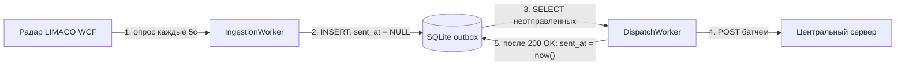
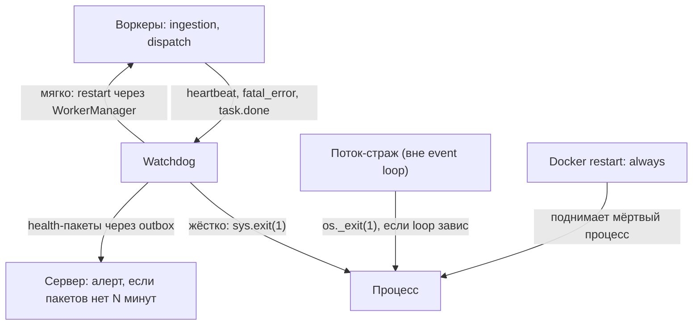
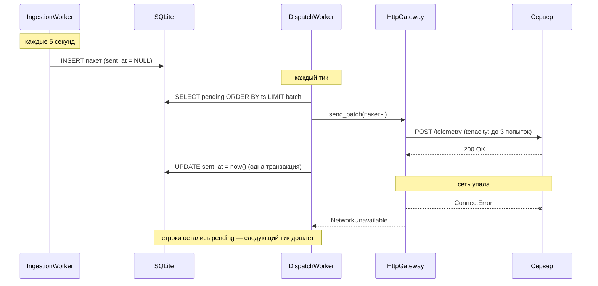
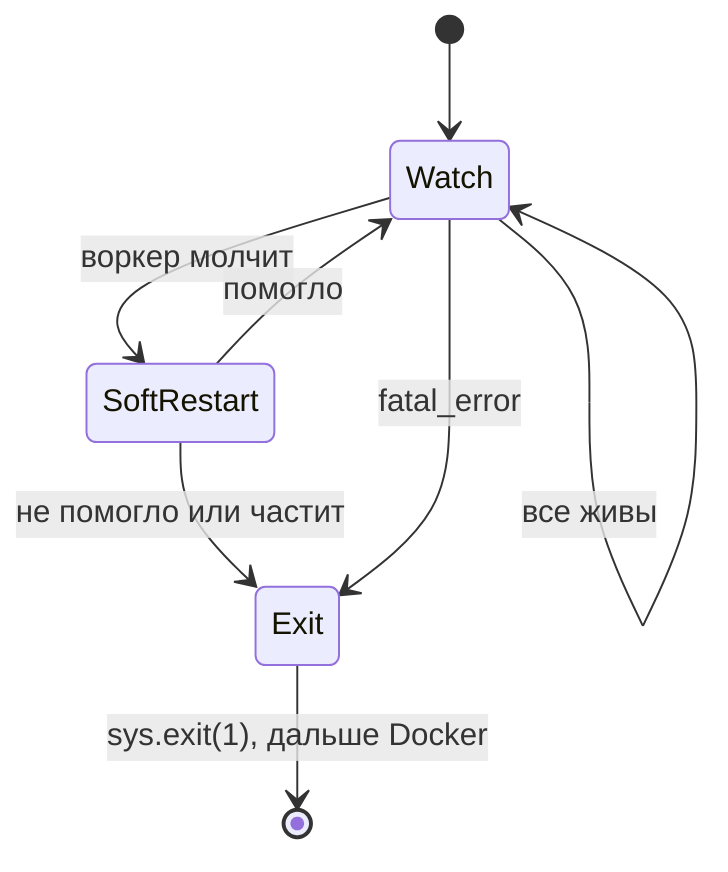

# EdgePC — архитектура сбора и доставки телеметрии

> Живой документ. Здесь: к какой архитектуре мы пришли, почему, из каких сервисов она состоит, как обрабатываются ошибки и что делать по шагам.

---

## 1. Главная идея в одном абзаце

Edge-устройство опрашивает радар (LIMACO WCF), **каждый пакет сразу пишет в локальную SQLite** и отдельным циклом отправляет на центральный сервер всё, что ещё не отправлено. Никаких очередей в памяти, никакого «определителя статуса сети», никакого отдельного механизма досылки: **неотправленные данные — это просто строки в таблице**, и один и тот же код отправляет и свежее, и накопившееся за сутки оффлайна.

Паттерн называется **transactional outbox** — дословно «исходящие». Аналогия с почтовым клиентом точная: письмо сначала попадает в папку «Исходящие» на диске, отправлялка шлёт из неё, когда есть связь, отправленное помечается. Пропал интернет — письма просто лежат в «Исходящих», никакой отдельной логики «что делать при оффлайне» не существует.

Следствие: процесс можно убить в любой момент (краш, OOM — когда система убивает процесс из-за нехватки памяти, выключили питание, watchdog сделал `sys.exit`) — теряется максимум один пакет, читавшийся с радара в этот миг; всё записанное доставляется после рестарта само.

---

## 2. Как читать этот документ (маршрут входа)

1. Прочитать документ сверху вниз, держа открытой схему из раздела 4.
2. Открыть код и проследить путь одного пакета от старта до записи в БД: `bootstrap._build_worker_manager` → `IngestionWorker.start` → `IngestionService.collect_once` → `WCFRadarAdapter.read_packet` → `SqlAlchemyTelemetryRepository.save`. Это займёт около получаса и покажет на живом коде большинство идей документа: слои, порты, доменные ошибки.
3. Посмотреть `src/domain/exceptions.py` — докстринги объясняют семантику каждой ошибки.
4. Реализовать TODO (раздел 10) по порядку: шаги 1–4 механические, шаг 5 — где живёт суть. Если шаг 5 понятен — архитектура понята.
5. После любого рефакторинга проверять правило слоёв «domain и application не импортируют infrastructure» одной командой: `rg "^from src" src/domain src/application` выводит все импорты внутри этих слоёв; если в выводе встретилось `infrastructure` — правило нарушено, зависимость надо развернуть через порт.

### Мини-словарь (термины, которые дальше используются без пояснений)

- **Порт** — абстрактный класс в `src/domain/ports/`: контракт «что система умеет», без ответа «как». Пример: `RadarAdapter` с одним методом `read_packet()`.
- **Тик** — одна итерация цикла воркера: сделал работу → обновил heartbeat → поспал интервал.
- **Event loop** — цикл asyncio, который в одном потоке по очереди выполняет все корутины. Если кто-то заблокировал поток — замирают все разом.
- **Реализация порта (адаптер)** — конкретный класс в `src/infrastructure/`, выполняющий контракт. У одного порта их несколько: `WCFRadarAdapter` (боевая), `MockRadarAdapter` (для отладки).
- **Outbox** — таблица «исходящих»: строки с `sent_at IS NULL` ждут отправки, с заполненным `sent_at` — отправлены.
- **Pending** — те самые неотправленные строки (`sent_at IS NULL`).
- **Батч** — пачка пакетов, отправляемая одним HTTP-запросом (чтобы после суток оффлайна не слать 17 000 запросов по одному).
- **Идемпотентность** — свойство сервера: повторный приём того же пакета не создаёт дубль. Нужна, потому что повторы отправки неизбежны.
- **Backoff** — растущая пауза между повторами неудавшегося запроса: 1с → 2с → 4с → 8с, чтобы не долбить лежащий сервер.
- **Джиттер** — случайная добавка к этой паузе (например, ±50%). Без неё сто устройств, потерявших сервер одновременно, будут и повторять одновременно — и снова его завалят.
- **Heartbeat** — отметка времени «я жив», которую воркер обновляет каждый тик; по её свежести Watchdog отличает работающий воркер от зависшего.
- **Dead man's switch** — «кнопка мертвеца»: тревога срабатывает не по сигналу, а по его *отсутствию*. У нас: сервер алертит, если от бункера долго нет пакетов.
- **TTL / ретенция** — срок хранения и правила очистки старых данных.
- **WAL** — режим журнала SQLite, при котором чтение и запись не блокируют друг друга (нужен, потому что два воркера работают с одной БД).
- **NAT** — роутер прячет устройства локальной сети за одним внешним адресом: изнутри наружу соединяться можно, снаружи внутрь — нельзя. Наш edge именно в таком положении.
- **SIGTERM** — сигнал ОС «завершись, пожалуйста». Его шлёт `docker stop`; процесс, который его обрабатывает, успевает завершиться корректно, который нет — через 10 секунд убивается насильно (SIGKILL).
- **Graceful shutdown** — корректное завершение по такому сигналу: доработать текущий тик, закрыть БД, и только потом умереть.
- **Поток-страж** — наш маленький компонент: обычный поток ОС вне asyncio, который проверяет, что event loop отвечает, и убивает процесс, если тот завис. Подробно — разделы 5 и 9.
- **Health-пакет** — запись «как дела у устройства» (состояние воркеров, глубина очереди, метрики железа), которую Watchdog кладёт в тот же outbox; на сервер едет как обычные данные.
- **DTO** (data transfer object) — класс под формат конкретного источника: «как радар отдаёт данные». Живёт только внутри адаптера.
- **ORM-модель** — класс под формат хранения: «как строка лежит в SQLite» (SQLAlchemy).
- **Инвариант** — правило, которое верно для сущности всегда: ровно 64 луча, `ts` с таймзоной. Нарушен — объект просто не создастся.

---

## 3. Как мы к этому пришли (эволюция)

Первоначальная схема (диаграмма v1):

```
Ingestion → payload_queue (RAM) → Router → [онлайн]  → Network Gateway
                                         → [оффлайн] → Fallback Cache (SQLite)
Fallback Cache → Retry Worker → Network Gateway (при появлении сети)
Shared Data: статус сети + пульсы
```

Проблемы, которые в ней нашли:

1. **payload_queue в RAM** — краш процесса теряет всё, что в очереди. Ради защиты от этого и затевался fallback, то есть схема противоречила собственной цели.
2. **Router с проверкой «сеть есть?»** — статус сети устаревает между проверкой и отправкой. Честная логика — «попробуй отправить», а не «спроси статус».
3. **Два пути кода** (онлайн/оффлайн) — оффлайн-путь выполняется редко, тестируется хуже всего, а нужен именно в аварию.
4. **Три источника правды** (очередь, кэш, Shared Data) — могут противоречить друг другу, гонки между Router/Retry/Shared Data.

Решение: писать в SQLite **всегда**, первым шагом. Тогда очередь не нужна (таблица и есть очередь, переживающая рестарт), Router не нужен (путь один), Retry Worker не нужен (досылка = обычная отправка), статус сети не нужен (есть pending-строки → шлём; не получилось → остались).

Цена: один INSERT на пакет (микросекунды) и задержка доставки до одного тика диспетчера (секунды). Для телеметрии раз в 5 секунд — несущественно.

### Сколько это экономит времени разработки — честная оценка

Разработка состоит из двух неравных частей, и экономия живёт только во второй:

1. **Написать код** — здесь схемы почти равны. Очередь, Router и Retry Worker — несложные компоненты, каждый пишется за вечер; старая схема потребовала бы на пару дней больше просто потому, что частей шесть, а не три. Если бы работа заканчивалась на «запустилось на столе при хорошей сети» — переделывать архитектуру не стоило бы.
2. **Довести до «уверенно работает, включая оффлайн и краши»** — отладка и тестирование. Именно эта часть занимает большую часть календаря, и именно здесь старая схема дорожает в разы: в ней баги — это гонки между шестью компонентами, а в новой — логика одной таблицы.

Поэтому дальше два итога не противоречат друг другу: «написать — одинаково» про пункт 1, «в 2 раза быстрее» — про сумму 1 + 2.

Оценка для одного разработчика без готовых наработок под такую схему, от текущего состояния кода до «уверенно работает, включая оффлайн-сценарии»:

**Старая схема (очередь + Router + Retry Worker + статус сети): ~5–7 недель.**

- Написать компоненты: ~2 недели. Шесть взаимодействующих частей: очередь, Router, определитель статуса сети, запись в fallback, Retry Worker, Gateway.
- Отладить взаимодействия: ~2–3 недели, и это оптимистично. Здесь живут худшие баги: Router проверил «сеть есть», сеть упала, пакет потерялся между очередью и Gateway; Retry Worker и Router одновременно шлют одни данные — дубли; статус сети «моргает» — пакеты мечутся между двумя путями; краш при непустой очереди — сколько потеряли, неизвестно. Каждый такой баг гонка: воспроизводится раз в N часов, в тестах не ловится, в логах выглядит как «иногда чего-то не хватает».
- Протестировать оффлайн-путь: ~1–2 недели. Два пути кода — двойной набор сценариев, причём аварийный путь надо искусственно провоцировать (рвать сеть в нужный момент между проверкой и отправкой — попробуй ещё попади).

**Новая схема (outbox): ~2–3 недели.**

- Шаги 1–7 TODO (колонка, репозиторий, DispatchService, воркер, сборка): ~1 неделя. Сердце — `dispatch_once` — 8 строк, и он уже написан в этом документе.
- Отладка взаимодействий: дни, а не недели, потому что взаимодействие одно: два воркера через одну таблицу. Гонок между «путями» нет — путь один. Состояние системы в любой момент видно одним SQL-запросом (`SELECT count(*) WHERE sent_at IS NULL`), а не размазано по очереди в RAM, кэшу и Shared Data.
- Тестирование оффлайна: почти бесплатно. Оффлайн — не отдельный путь, а тот же код с непустой очередью: mock-гейтвей с fail rate 0.5 прогоняет «аварийный» сценарий каждые несколько секунд прямо на столе.

Ещё две-три недели в обеих схемах уходят одинаково — Watchdog, страж, SIGTERM, договорённости с сервером: это не зависит от выбора схемы доставки.

Итого по компоненту доставки: **примерно в 2 раза быстрее до продакшена** (2–3 недели против 5–7). Но главная экономия даже не тут, а в сопровождении: баг в outbox-схеме — это «посмотри одну таблицу и лог одного воркера», баг в старой — «восстанови по логам, в каком из трёх источников правды и на каком из двух путей потерялся пакет», причём удалённо, на устройстве за NAT, куда нельзя подключиться. Один такой инцидент на проде стоит недели.

Оговорка, чтобы оценка осталась честной: цифры — для этого проекта и этого контекста (один разработчик, без готовых наработок под распределённую доставку, устройства недоступны снаружи). Команда с такими наработками сократила бы обе оценки, но соотношение «в разы дороже отлаживать гонки, чем таблицу» осталось бы.

---

## 4. Схемы: поток данных и надзор — отдельно

Две независимые картинки, потому что это две независимые заботы: первая — «как пакет доезжает до сервера», вторая — «кто за кем следит».

### Поток данных (читать слева направо)



Если шаг 4 не удался — шаг 5 не происходит, строки остаются в таблице, и следующий тик начнёт снова с шага 3. Это весь механизм устойчивости к оффлайну.

### Цепочка надзора (каждый уровень проще предыдущего)



Принцип: каждый следующий уровень тупее и надёжнее предыдущего. Воркеры сложные, Watchdog — простой цикл, поток-страж — три строчки, Docker — чужой отлаженный код, серверный алерт — вообще не код edge-устройства. Чем выше поднимается отказ, тем примитивнее механизм, который его ловит.

---

## 5. Сервисы: что делает каждый и зачем он нужен

### IngestionWorker + IngestionService — есть, работает

- **Имя:** ingestion (англ. «приём, заглатывание») — стандартный термин для «затащить данные в систему». Этот сервис — вход: всё, что попадает в систему, попадает через него.
- **Что делает:** раз в 5 секунд читает пакет с радара через порт `RadarAdapter` и сохраняет в SQLite через порт `TelemetryRepository`. (Статус «не отправлено» появится вместе с колонкой `sent_at` в шаге 1 TODO — сейчас пакеты просто сохраняются.)
- **Чего НЕ делает:** не знает про сеть, сервер и отправку. Радар лежит — воркер ретраит тиками и останавливается после N подряд сбоев.
- **Почему так:** сбор не должен зависеть от состояния канала — это весь смысл буферизации на диске.

### DispatchWorker + DispatchService — новый, главный из новых

- **Имя:** dispatch (англ. «отправка, диспетчеризация») — как диспетчер на складе: смотрит, какие грузы накопились (pending-строки), собирает партию (батч), отправляет, отмечает отгруженное в журнале (`sent_at`). Он не производит данные и не возит их сам — он *распоряжается отправкой*. Имя «Sender» было бы уже (сервис ещё и помечает, и порядок соблюдает), «Router» — враньё (маршрут один).
- **Что делает:** раз в N секунд берёт из БД пачку неотправленных строк (по порядку времени), отправляет через порт `NetworkGateway` (о нём — следующий подраздел), по подтверждению помечает `sent_at = now()` одной транзакцией. Удалением занимается ретенция (см. раздел 8), не отправка.
- **Заменяет собой** Router, Retry Worker и «отправку из Gateway» из старой схемы — «отправить всё неотправленное» покрывает и свежие данные, и досылку после оффлайна.
- **Оффлайн для него — штатный режим:** отправка не удалась → строки остались pending → следующий тик попробует снова.

### NetworkGateway (порт) и его реализации — новые

Последовательность здесь такая же, как у радара: сначала контракт в domain, потом взаимозаменяемые реализации в infrastructure.

- **Имя:** gateway (англ. «шлюз, ворота») — единственная дверь, через которую данные покидают устройство. Всё сетевое (адреса, токены, повторы, HTTP-коды) живёт за этой дверью; остальной код знает только «отдай пачку наружу».
- **Порт `NetworkGateway`** (`src/domain/ports/network_gateway.py`) — весь контракт один метод:

```python
class NetworkGateway(ABC):
    @abstractmethod
    async def send_batch(self, packets: list[TelemetryPacket]) -> None:
        """Доставить пачку. Не доставил — кидай NetworkUnavailable."""
```

  `DispatchService` зависит только от этого класса и не знает, какая реализация подставлена.
- **`MockNetworkGateway`** (infrastructure) — реализация для разработки: «отправляет» в лог и падает с заданной вероятностью, чтобы прогонять досылку без реального сервера. По образцу mock-радара.
- **`HttpGateway`** (infrastructure) — боевая реализация: HTTP POST батча на сервер. Внутри tenacity делает 2–3 повтора с растущей паузой и джиттером (см. словарь в разделе 2: пауза 1с → 2с → 4с, плюс случайная добавка, чтобы сто бункеров не повторяли синхронно). Любую сетевую ошибку переводит в доменную `NetworkUnavailable` — Dispatch видит одну понятную ошибку вместо зоопарка httpx-исключений.
- **Edge не знает, что на сервере.** Сегодня сервер пишет в Postgres, завтра поставит Kafka за тем же HTTP-эндпоинтом — код edge не меняется.

### Watchdog — новый, пишется последним

- **Имя:** watchdog (англ. «сторожевой пёс») — устоявшийся термин из embedded-систем: компонент, который сам ничего полезного не делает, а только следит, что остальные живы, и поднимает тревогу.
- **Что делает:** наблюдает за воркерами по трём агрегированным сигналам (раздел 9, контур 2), принимает решения об эскалации, собирает health-пакеты в тот же outbox.
- **Чего НЕ делает:** не видит отдельные ошибки тиков (это работа воркеров) и не выполняет механику рестартов (это работа WorkerManager и Docker).

### Поток-страж event loop — новый, самый маленький

- **Что делает:** обычный `threading.Thread` вне asyncio; проверяет, что event loop отвечает (метка времени через `call_soon_threadsafe`), и делает `os._exit(1)`, если loop завис. Единственный компонент, который переживает зависание всего asyncio-мира — его планирует ОС, а не event loop.
- **Чего НЕ делает:** ничего больше. Три строчки логики, ноль зависимостей — именно поэтому ему можно доверять, когда всё остальное встало. Подробности — раздел 9, «А если завис сам Watchdog?».

### WorkerManager — есть

- Запускает всех воркеров, умеет `stop_all()` и `health_report()`. Добавится: `restart(name)` — отменить задачу воркера и создать заново (механика для решений Watchdog). Принимает любой объект с протоколом `Worker` — новые воркеры добавляются одной строкой в bootstrap.

---

## 6. Модели данных: почему их три вида

Правило чистой архитектуры: доменная модель описывает «что такое телеметрия», ORM-модель — «как она лежит в SQLite», DTO — «в каком виде её отдаёт конкретный источник». Меняются они по разным причинам, поэтому это разные классы.

### Доменные (`src/domain`) — pydantic, frozen, с инвариантами

- **`TelemetryPacket`** — ts, avg_level, mass, volume, beams, source_state.
  Инварианты: `ts` обязан иметь таймзону; ровно 64 луча; масса/объём/уровень могут быть `None` (источник не прислал значение).
- **`Beam`** — height, raw_status, status.
  Инварианты: height без NaN/Inf (отрицательная — можно, это ниже опорной точки); неизменяемый.
- **`Measurement`** (тип) — `float`, конечный, ≥ 0. Общий тип для физических величин.

Инварианты лежат в domain (а не в DTO), чтобы срабатывать для **любого** источника — WCF, mock, будущий Modbus.

### DTO (`src/infrastructure/radar/wcf`) — причуды формата источника

`WCFVesselDTO`, `WCFBeamDTO`, `WCFDataDTO` — разворачивают zeep-структуры, парсят строковый ответ `GetData`, отбраковывают NaN. Живут только внутри WCF-адаптера, наружу не выходят.

### ORM (`src/infrastructure/database/models`) — SQLAlchemy

`TelemetryPacketModel`: колонки пакета + `id`, `beams` как JSON, индекс по `ts`.
**Добавится:** `sent_at: datetime | None` с индексом — `NULL` означает «не отправлено».

### StoredPacket — добавится в `domain/ports`

Frozen-датакласс `(id, packet)` — то, что возвращает `fetch_pending`: доменный пакет плюс ключ хранения, чтобы после отправки пометить `sent_at` именно у этих строк. `id` в саму сущность не добавляем — это деталь хранения. Подробный разбор с кодом — TODO, шаг 2.

---

## 7. Как сервис понимает, что нет интернета

Короткий ответ: **никак не проверяет заранее — узнаёт, попробовав отправить.** Это осознанное решение, а не пробел:

- Любая предварительная проверка (ping, запрос статуса, флаг в Shared Data) устаревает в момент завершения: сеть может упасть между проверкой и отправкой. Единственный честный тест канала — сама отправка.
- Попытка отправки и есть проверка: `HttpGateway` делает POST; не получилось → кидает `NetworkUnavailable` → Dispatch ничего не помечает → строки остались pending. Получилось → канал, очевидно, есть.
- Поэтому статус сети **вычисляется, а не хранится**: глубина очереди (`COUNT(*) WHERE sent_at IS NULL`) растёт → канал лежит (или сервер); тает → всё работает. Watchdog кладёт эту метрику в health-пакет.

Что при этом различимо, если захочется деталей в логах: httpx отдаёт разные исключения для «нет сети вообще» (`ConnectError`, DNS-ошибки), «сервер не отвечает» (`ConnectTimeout`, `ReadTimeout`) и «сервер отвечает, но плохо» (HTTP 5xx). Для поведения edge разницы нет — во всех случаях строки остаются pending, — но в лог и health-пакет стоит писать тип ошибки: оператору это скажет, чинить связь или сервер.

Состояние **источника** (радара) — отдельная вещь: enum `SourceState` (`HEALTHY` / `WCF_DOWN` / `WCF_RECOVERED`) едет внутри самого пакета, чтобы сервер отличал «радар лежал» от «связи не было». Честная оговорка о текущем коде: сейчас маппер всегда ставит `HEALTHY` — вычисление реального состояния предстоит сделать (иначе enum бесполезен).

---

## 8. Отправка на центральный сервер: полный цикл

### Топология: у edge нет публичного IP — соединение всегда исходящее

Edge PC стоит за NAT (LTE-модем / роутер объекта), публичного адреса у него нет. Значит, **все соединения инициирует edge, сервер не может достучаться до устройства в принципе**. Это не ограничение, которое надо обходить, — это упрощение, вокруг которого архитектура уже построена: edge только «выносит» данные наружу.

**Что это означает для Edge PC:**

- нужен только **исходящий** HTTPS (порт 443) до публичного адреса/домена сервера — работает через любой NAT без настройки проброса портов;
- на устройстве не слушается ни один входящий порт — нечего атаковать и нечего настраивать на роутере объекта;
- адрес сервера — конфигурация: `DISPATCH__SERVER_URL=https://telemetry.example.com` в `.env`;
- аутентификация «кто ты такой» — токен бункера в заголовке запроса (`Authorization: Bearer ...`), выдаётся при установке устройства, лежит в `.env`;
- TLS обязателен — данные идут через публичный интернет.

**Что это означает для центрального сервера:**

- публичный IP/домен, TLS-сертификат, эндпоинт `POST /telemetry` (health-пакеты — туда же или соседний `POST /health`);
- проверка токена, дедупликация по `bunker_id + ts`, атомарный приём батча;
- `last_seen` и dead man's switch — **единственный** способ узнать о проблеме на объекте: сервер не может пингануть edge, опросить его состояние или «попросить дослать». Всё, что серверу нужно знать, edge должен принести сам — поэтому health-пакеты и едут с устройства, а не запрашиваются с сервера.

Если когда-нибудь понадобится управление устройством с сервера (сменить интервал, форсировать что-то) — при такой топологии это делается только «попутно»: edge спрашивает сам, например сервер кладёт команды в ответ на POST health-пакета. Либо VPN (WireGuard/Tailscale) — но это отдельное решение с отдельными рисками, сейчас не нужно.

### Цикл отправки



Договорённости с сервером (важно, из первоисточников):

- **Идемпотентность обязательна.** Outbox-паттерн гарантирует доставку «хотя бы раз», а не «ровно раз»: Dispatch может отправить пакет, упасть до пометки `sent_at` и после рестарта отправить его снова. Сервер обязан дедуплицировать — по ключу `bunker_id + ts` (это наш аналог idempotency key у Stripe).
- **`bunker_id` добавляет гейтвей, не сущность.** В `TelemetryPacket` его нет и не должно быть — устройство одно, это контекст отправки, а не свойство измерения. `HttpGateway` получает `bunker_id` из настроек при сборке и вставляет в тело/заголовок запроса.
- **Батч подтверждается целиком.** Либо 200 — и весь батч помечается отправленным, либо ошибка — и не помечается ничего. Частичных подтверждений нет; дубли при повторе батча гасит серверная дедупликация.
- **Часы на edge должны быть верными.** Ключ идемпотентности и порядок доставки держатся на `ts` с устройства: уехавшие часы = невидимые дубли и дыры в данных. На устройстве обязателен NTP (chrony/systemd-timesyncd), а в health-пакет стоит класть текущее время устройства — сервер сравнит со своим и заметит дрейф.
- **Джиттер в ретраях.** Если сервер лежал и поднялся, все бункеры начнут досылать одновременно и могут его же и положить — это называется thundering herd, «топочущее стадо». Поэтому в tenacity — не чистая экспонента (1с → 2с → 4с у всех одинаково), а `wait_random_exponential` (у каждого своя случайная пауза около этих значений); интервал тика Dispatch тоже стоит слегка рандомизировать.
- **Батчи ограничены** (100–500 пакетов): после суток оффлайна в outbox ~17 000 строк, слать одним запросом нельзя.

**Ретенция — принятое решение** (одно, чтобы не разъезжалось по коду):

- отправленные строки **помечаются** `sent_at = now()`, а удаляет их ретенция — `purge` чистит отправленные старше TTL (например, 7 дней): бесплатная локальная история для отладки;
- **pending не удаляется автоматически никогда** — это недоставленные данные. Защита от переполнения диска при многонедельном оффлайне — не тихое удаление, а алерт: глубина очереди и размер БД едут в health-пакете, порог диска проверяет Watchdog. Если когда-то понадобится жертвовать данными — это будет явная политика, принятая отдельно, а не побочный эффект.

Два уровня ретраев с разными ролями:

- **Короткий (секунды)** — tenacity внутри HttpGateway: моргнула сеть, таймаут одного запроса. 2–3 попытки — и сдаёмся.
- **Длинный (часы/сутки)** — тики DispatchWorker поверх outbox: сервер лежит, кабель выдернут. Строки ждут в БД сколько нужно.

---

## 9. Ошибки: три контура

Ошибки живут в трёх независимых контурах. Путаница возникает, когда их смешивают, поэтому разводим явно.

### Контур 1 — обработка в момент возникновения (внутри тика воркера)

Что бы ни сломалось в глубине (DTO не распарсился, zeep кинул таймаут, SQLite занята) — исключение поднимается по стеку вызовов **внутри текущего тика**: адаптер/репозиторий переводит его в доменное, воркер ловит и реагирует немедленно. Watchdog в этом контуре не участвует вообще — ошибка обработана за миллисекунды до того, как кто-либо снаружи мог бы её заметить.

> [!NOTE]
> **Словарь доменных ошибок и реакция воркера**
> - **`RadarSourceUnavailable`** — радар временно недоступен → лог warning, +1 к счётчику сбоев, следующий тик.
> - **`RadarSourceMisconfigured`** — конфигурация неверна → воркер ставит `fatal_error` и останавливается: ретраи бессмысленны.
> - **`RadarDataInvalid`** — конкретный пакет мусорный (NaN, не 64 луча) → лог, пропуск тика, сбоем НЕ считается.
> - **`TelemetryStorageError`** — не записалось в SQLite → лог error, +1 к счётчику.
> - **`NetworkUnavailable`** (добавится) — не отправилось на сервер → для Dispatch штатно: лог, ждать следующего тика.

Итог каждого тика воркер записывает в своё состояние: `_consecutive_failures`, `_last_heartbeat`, `_fatal_error`. Это состояние — интерфейс между контуром 1 и контуром 2.

### Контур 2 — надзор (Watchdog): видит состояния, а не ошибки

Ответ на вопрос «как Watchdog увидит ошибку в DTO?» — **никак, и это правильно**. Отдельные ошибки — не его уровень. Он периодически (своим тиком, других механизмов и не нужно — всё в одном процессе, состояние воркеров доступно напрямую) читает три агрегированных сигнала:

1. `worker.is_alive()` — heartbeat обновлялся недавно → воркер крутится (пусть даже все тики неудачные — он жив и сам справляется);
2. `worker.fatal_error` — воркер сам признал, что не может продолжать;
3. `task.done()` — задача воркера завершилась, хотя не должна была (из цикла вылетело неперехваченное исключение).

Кто что **делает** (решение и механика разделены):

- **Watchdog решает** — по таблице, без интеллекта.
- **WorkerManager выполняет** мягкие меры: `restart(name)` = cancel задачи + пересоздание воркера.
- **Watchdog выполняет** жёсткую меру сам: `sys.exit(1)` — это последний код, который выполняется внутри процесса.
- **Docker выполняет** рестарт контейнера: демон Docker снаружи процесса видит его смерть и поднимает заново (`restart: always`). Внутри процесса рестарт контейнера не делает никто — изнутри это невозможно и не нужно.



- «воркер молчит» = heartbeat старше `max_silence` или `task.done()` без fatal_error;
- «помогло» = после `restart(name)` heartbeat снова обновляется, и рестартов < K за окно (например, 3 за 10 минут);
- «не помогло или частит» = cancel не завершился за 10с (задача застряла в блокирующем вызове) или > K рестартов за окно — проблема системная, мягкие меры не работают.

### А если завис сам Watchdog?

Честный разбор. У «зависшего Watchdog» есть два принципиально разных сценария:

**Сценарий А — завис только Watchdog, event loop жив.** Маловероятен по построению: Watchdog должен быть тривиальным циклом — читает поля объектов-воркеров (без I/O), пишет health-пакет в локальную SQLite, спит. Ни сети, ни блокирующих вызовов в его тике нет, зависать не на чем. Это правило конструкции: **в тик Watchdog нельзя добавлять сетевые вызовы** — отправкой health-пакетов занимается Dispatch, как и любыми другими данными.

**Сценарий Б — встал весь event loop** (кто-то заблокировал поток: тяжёлый синхронный вызов мимо `to_thread`, бесконечный цикл в корутине). Тогда замирает всё сразу: и воркеры, и Watchdog, и его таблица решений. Изнутри asyncio это не обнаружит никто — код просто не выполняется. Для этого в цепочке надзора есть **поток-страж** (см. схему в разделе 4): обычный `threading.Thread`, живущий вне event loop. Механика в три строчки: страж периодически просит loop обновить метку времени через `loop.call_soon_threadsafe(...)`; сам поток (его планирует ОС, а не asyncio — зависание loop его не трогает) проверяет свежесть метки; метка протухла дольше порога → `os._exit(1)`. Именно `os._exit`, а не `sys.exit`: нужно убить процесс немедленно, без раскрутки исключений через тот самый повисший loop. Дальше стандартно — Docker поднимает контейнер, outbox гарантирует, что данные целы.

**Последний рубеж — центральный сервер (dead man's switch).** Если от бункера нет ни телеметрии, ни health-пакетов дольше порога (например, 10 минут) — алерт оператору. Этот уровень ловит то, что не может поймать ничто на устройстве: умерло само железо, питание, канал пропал надолго, Docker не поднимает контейнер. Edge-код для этого не нужен — только правило на приёмной стороне: «фиксируй last_seen по каждому bunker_id и алерть по тишине».

Итого цепочка «кто сторожит сторожа» замыкается без бесконечной рекурсии: воркеров сторожит Watchdog, event loop — поток-страж, процесс — Docker, устройство целиком — сервер. Каждый уровень примитивнее предыдущего, поэтому вероятность его собственного отказа ниже.

### Контур 3 — ошибки как данные (доставка на сервер)

Чтобы оператор на центральном сервере видел проблемы edge-устройства, ошибки должны стать **данными в outbox** — тогда они доставляются с теми же гарантиями, что и телеметрия:

- Воркеры уже хранят агрегаты: счётчик сбоев, fatal_error; добавим «последняя ошибка + когда». `WorkerManager.health_report()` их собирает.
- Watchdog своим тиком формирует **health-пакет**: отчёт воркеров + глубина pending-очереди + метрики железа (psutil) + счётчик рестартов — и кладёт его в outbox (отдельная таблица или тип записи).
- Для событий уровня «воркер перезапущен», «fatal_error» — то же самое: запись-событие в outbox в момент решения Watchdog.
- Полные логи с edge не тянем — дорого; на сервер едут факты и счётчики, подробности остаются в локальном лог-файле для разбора на месте.

Так замыкается цепочка: ошибка обработана мгновенно (контур 1), деградация замечена и устранена (контур 2), сервер узнал и о том, и о другом (контур 3).

### Защита от зависаний — почему `task.cancel()` не гарантия и что вместо

`cancel()` доставляет `CancelledError` только в ближайший `await`; задачу, застрявшую в блокирующем вызове, изнутри процесса не убить. Пять эшелонов:

1. **Таймауты на каждой I/O-границе** (у WCF уже стоит `timeout=5`; то же — в HTTP-гейтвее). Вызов без таймаута = источник незакилливаемых задач.
2. **Дедлайн на тик**: `async with asyncio.timeout(...)` вокруг тела тика — превышение считается сбоем, воркер живёт дальше.
3. **Не глотать отмену**: `except Exception` не ловит `CancelledError` — так и оставить.
4. **Watchdog** — детектор и эскалатор (контур 2).
5. **Смерть процесса + Docker** — единственная стопроцентная гарантия. Благодаря outbox рестарт безопасен.

### Поведение при крашах — сводка

- **Ошибка одного тика** → замечает сам воркер → лог, следующий тик. Потерь нет.
- **Тик завис** → `asyncio.timeout` → тик прерван, засчитан как сбой. Потерь нет.
- **Воркер завис целиком** → Watchdog по heartbeat → `restart(name)`, при повторах `sys.exit(1)`. Потерь нет.
- **fatal_error у воркера** → Watchdog → `sys.exit(1)` → Docker поднимает контейнер. Потерь нет.
- **Завис весь event loop (включая Watchdog)** → поток-страж вне loop → `os._exit(1)` → Docker. Потерь нет.
- **Краш процесса / OOM / питание** → Docker → рестарт контейнера. Потери: максимум один пакет, читавшийся с радара в момент смерти.
- **Умерло железо / Docker не поднимает / канал пропал совсем** → сервер по тишине (dead man's switch) → алерт оператору. Данные до момента смерти лежат в SQLite на устройстве.
- **Сервер лежит сутки** → никто не «замечает», это штатный режим → pending копится, после восстановления уходит батчами. Потерь нет.

Всё, что легло в SQLite, переживает любой сценарий из списка.

---

## 10. TODO — порядок реализации (что, где, зачем)

Каждый шаг проверяем сразу после завершения. Рискованные решения — раньше.

- [ ] **1. Колонка `sent_at` + WAL**
      **Где:** `src/infrastructure/database/models/telemetry_packet.py`, `src/infrastructure/database/sqlite_client.py`.
      **Что:** в модель добавить `sent_at: Mapped[datetime | None] = mapped_column(index=True, default=None)`; в клиенте после создания engine включить `PRAGMA journal_mode=WAL` и на каждый connect ставить `busy_timeout` (в SQLAlchemy — обработчик события `connect`). Пересоздать dev-базу.
      **Зачем `sent_at`, а не флаг `is_sent`:** одна колонка отвечает на три вопроса — отправлен ли пакет (`NULL` = нет), *когда* отправлен (для отладки «почему данные пришли с опозданием») и что можно чистить (ретенция удаляет по возрасту `sent_at`). Булев флаг дал бы только первый ответ.
      **Зачем WAL:** два воркера работают с одной БД одновременно (ingestion пишет, dispatch читает и помечает); в дефолтном режиме SQLite они блокировали бы друг друга, ловя `database is locked`. WAL включается один раз и сохраняется в файле БД; `busy_timeout` — свойство соединения, ставится на каждое.
      **На будущее:** пока схема меняется — пересоздаём dev-базу; перед выкаткой на устройства понадобится [Alembic](https://alembic.sqlalchemy.org/) — на проде базу не пересоздать.
      Читать: [SQLite WAL](https://www.sqlite.org/wal.html), [Transactional Outbox](https://microservices.io/patterns/data/transactional-outbox.html)

- [ ] **2. `StoredPacket` — конверт «пакет + его id в БД»**
      **Где:** `src/domain/ports/telemetry_repository.py` (рядом с портом).
      **Что:**

      ```python
      @dataclass(frozen=True)
      class StoredPacket:
          id: int                    # ключ строки в outbox
          packet: TelemetryPacket    # сам доменный пакет
      ```

      **Зачем он нужен:** Dispatch должен после успешной отправки пометить **именно те строки, которые отправил**. Но доменный `TelemetryPacket` не знает своего id в БД — и не должен (id — деталь хранения, пакет как измерение существует и до записи в БД). `StoredPacket` решает это без загрязнения сущности: репозиторий достаёт строки и отдаёт их «в конверте с обратным адресом».
      **Куда он потом:** живёт только на отрезке репозиторий → DispatchService: `fetch_pending()` возвращает `list[StoredPacket]`; сервис отправляет содержимое (`[sp.packet for sp in batch]`) и помечает по адресам (`mark_sent([sp.id for sp in batch])`). В гейтвей, на сервер и в domain-логику id не попадает.

- [ ] **3. Расширить порт `TelemetryRepository` и его реализацию**
      **Где:** порт — `src/domain/ports/telemetry_repository.py`; реализация — `src/infrastructure/database/repositories/telemetry_repository.py`.
      **Что:** к существующему `save()` добавить четыре метода:
      - `fetch_pending(limit) -> list[StoredPacket]` — `SELECT ... WHERE sent_at IS NULL ORDER BY ts LIMIT n` (порядок по `ts` — чтобы сервер получал данные хронологически);
      - `mark_sent(ids)` — `UPDATE ... SET sent_at = now() WHERE id IN (...)`, одна транзакция;
      - `purge_sent_older_than(ttl)` — `DELETE ... WHERE sent_at IS NOT NULL AND sent_at < now() - ttl` (только отправленные! pending не трогаем — решение из раздела 8);
      - `count_pending()` — метрика глубины очереди для health-пакета.
      **Зачем в порте, а не просто в репозитории:** DispatchService (application) может зависеть только от абстракции в domain — иначе application узнает про SQLAlchemy и слои поедут.
      Читать: [SQLAlchemy 2.0 async](https://docs.sqlalchemy.org/en/20/orm/extensions/asyncio.html), [select с limit/order_by](https://docs.sqlalchemy.org/en/20/tutorial/data_select.html)

- [ ] **4. Порт `NetworkGateway` + `NetworkUnavailable` + мок**
      **Где:** порт — `src/domain/ports/network_gateway.py`, один метод `async send_batch(packets: list[TelemetryPacket]) -> None` (код контракта — в разделе 5); ошибка — в `src/domain/exceptions.py`; мок `MockNetworkGateway` — `src/infrastructure/network/mock_gateway.py`.
      **Зачем порт:** контракт «умею доставлять пакеты наружу», за которым прячется HTTP (а завтра — что угодно). Контракт ошибки: не доставил — кидай `NetworkUnavailable`, других исключений наружу не выпускай.
      **Зачем мок:** гонять всю dispatch-ветку без реального сервера — по образцу mock-радара, с настраиваемым fail rate — долей искусственных сбоев (`MOCK__GATEWAY_FAIL_RATE=0.5` → падает каждая вторая «отправка»). На нём же увидите накопление и досылку pending.

- [ ] **5. `DispatchService` — единственное место с логикой отправки**
      **Где:** `src/application/dispatch/service.py`.
      **Что (это весь сервис, конкретно):**

      ```python
      class DispatchService:
          def __init__(self, repository, gateway, batch_size): ...

          async def dispatch_once(self) -> int:
              batch = await self._repository.fetch_pending(self._batch_size)
              if not batch:
                  return 0                     # нечего отправлять — не ошибка
              await self._gateway.send_batch([sp.packet for sp in batch])
              await self._repository.mark_sent([sp.id for sp in batch])
              return len(batch)
      ```

      **Почему это «сердце»:** порядок строк и есть гарантия недоставки-без-следа — пометка строго после успешной отправки. Упали между `send_batch` и `mark_sent` → пакеты уйдут повторно → дубли гасит сервер. Обратный порядок (пометить, потом слать) терял бы данные.
      **Тесты:** первые юнит-тесты проекта именно здесь — фейковый репозиторий (список в памяти) + фейковый гейтвей (падает по флагу): проверить «не помечает при сбое», «помечает после успеха», «пустая очередь — не ошибка».
      Читать: [pytest](https://docs.pytest.org/en/stable/), [pytest-asyncio](https://pytest-asyncio.readthedocs.io/en/latest/)

- [ ] **6. `DispatchWorker` + `DispatchSettings`**
      **Где:** `src/application/dispatch/worker.py` — копия структуры `IngestionWorker` (цикл-тик, счётчик сбоев, heartbeat, обработка доменных ошибок; `NetworkUnavailable` — штатная: лог + ждать тик). Настройки — класс `DispatchSettings` в `src/config/settings.py`: `interval`, `batch_size`, `retention_ttl`, `server_url`, `auth_token`.
      Читать: [pydantic-settings](https://docs.pydantic.dev/latest/concepts/pydantic_settings/)

- [ ] **7. Сборка и смоук-прогон** (смоук — минимальный запуск «оно вообще работает?», без детальных проверок)
      **Где:** `src/bootstrap.py`, функция `_build_worker_manager` — создать гейтвей (пока мок), `DispatchService`, `DispatchWorker`, добавить воркер в список `workers=[...]`. Удалить пустые `src/application/router/` и `src/application/fallback/`.
      **Проверка:** запуск с mock-радаром и mock-гейтвеем с fail rate ~0.5 — в логах видно, как pending копится при сбоях и досылается после; `sqlite3 data/telemetry.db "SELECT count(*) FROM telemetry_packet WHERE sent_at IS NULL"` показывает очередь.

- [ ] **8. `HttpGateway` — реальная отправка**
      **Где:** `src/infrastructure/network/http_gateway.py`, реализация порта из шага 4.
      **Что:** httpx.AsyncClient с таймаутом; tenacity `wait_random_exponential` (джиттер — против thundering herd: после подъёма сервера все бункеры досылают одновременно); `bunker_id` и токен из настроек — в заголовки/тело (в доменной сущности их нет — это контекст отправки); перевод `httpx.ConnectError/TimeoutException/5xx` → `NetworkUnavailable`.
      **Согласовать с сервером:** формат тела, ключ идемпотентности `bunker_id + ts`, атомарность приёма батча (либо принял весь, либо никакой), аутентификация по токену.
      Читать: [httpx async](https://www.python-httpx.org/async/), [tenacity: wait_random_exponential](https://tenacity.readthedocs.io/en/latest/#waiting-before-retrying), [Stripe: idempotency](https://stripe.com/blog/idempotency) — короткая и очень полезная, целиком

- [ ] **9. Ретенция** — вызов `purge_sent_older_than(ttl)` шагом в тике dispatch (после успешной отправки). Pending не трогаем; переполнение диска — алерт через health-пакет, не удаление.

- [ ] **9а. NTP на устройстве** — проверить/настроить chrony или systemd-timesyncd; в health-пакет добавить текущее время устройства. **Зачем:** ключ идемпотентности `bunker_id + ts` держится на часах edge — уехавшие часы = невидимые дубли и дыры, сервер заметит дрейф только если edge присылает своё время.

- [ ] **10. Дедлайн тика + SIGTERM**
      **Где:** оба воркера — `async with asyncio.timeout(deadline)` вокруг тела тика (превышение = сбой, не зависание); `src/bootstrap.py` — `loop.add_signal_handler(SIGTERM, ...)`.
      **Зачем SIGTERM:** `docker stop` шлёт SIGTERM, а не SIGINT; без обработчика контейнер будет убиваться по таймауту вместо graceful shutdown.
      Читать: [asyncio.timeout](https://docs.python.org/3/library/asyncio-task.html#asyncio.timeout), [Task.cancel — почему не гарантия](https://docs.python.org/3/library/asyncio-task.html#asyncio.Task.cancel), [loop.add_signal_handler](https://docs.python.org/3/library/asyncio-eventloop.html#asyncio.loop.add_signal_handler)

- [ ] **11. Watchdog + `WorkerManager.restart(name)`**
      **Где:** `src/application/watchdog/worker.py` + метод `restart(name)` в `src/application/worker_manager.py` (cancel задачи → пересоздание). Логика — три сигнала и таблица решений из раздела 9, счётчик рестартов за окно. Health-пакет (отчёт воркеров, `count_pending()`, psutil-метрики, время устройства) — записью в outbox. Правило: в тике Watchdog никаких сетевых вызовов — только чтение состояния и запись в локальную БД.
      Читать: [psutil](https://github.com/giampaolo/psutil), философия — [Crash-only software (PDF)](https://www.usenix.org/legacy/events/hotos03/tech/full_papers/candea/candea.pdf)

- [ ] **12. Поток-страж event loop**
      **Где:** `src/bootstrap.py`, запускается в начале `bootstrap_application` — потоку нужна ссылка на уже работающий loop. `threading.Thread(daemon=True)`: просит loop обновлять метку через `loop.call_soon_threadsafe`, проверяет её свежесть; протухла → `os._exit(1)` (не `sys.exit` — нужен выход без участия повисшего loop). Ловит «встал весь event loop вместе с Watchdog».
      Читать: [loop.call_soon_threadsafe](https://docs.python.org/3/library/asyncio-eventloop.html#asyncio.loop.call_soon_threadsafe), [os._exit](https://docs.python.org/3/library/os.html#os._exit)

- [ ] **13. Dead man's switch на центральном сервере** — фиксировать `last_seen` по каждому `bunker_id` (любой входящий пакет); тишина дольше порога (например, 10 минут) → алерт оператору. При топологии «edge за NAT» это единственный способ узнать о смерти железа/питания/канала — сервер не может опросить устройство сам. Кода на edge не требует.

---

## 11. Технологии в проекте — краткий словарь

Что уже стоит:

- **pydantic v2** — доменные модели с инвариантами и DTO. [docs.pydantic.dev](https://docs.pydantic.dev/latest/)
- **pydantic-settings** — конфиг из `.env` с вложенностью через `__`. [docs](https://docs.pydantic.dev/latest/concepts/pydantic_settings/)
- **SQLAlchemy 2.0 async + aiosqlite** — ORM поверх SQLite. [asyncio-docs](https://docs.sqlalchemy.org/en/20/orm/extensions/asyncio.html), [aiosqlite](https://github.com/omnilib/aiosqlite)
- **loguru** — логирование с bind-контекстом. [repo](https://github.com/Delgan/loguru)
- **zeep** — SOAP/WCF-клиент для радара. [docs.python-zeep.org](https://docs.python-zeep.org/)
- **asyncio** — воркеры, отмена, таймауты. [Tasks and coroutines](https://docs.python.org/3/library/asyncio-task.html)

Добавится по ходу TODO: **httpx** (шаг 8), **tenacity** (шаг 8), **psutil** (шаг 11), **pytest + pytest-asyncio** (шаг 5).

Общая теория, один раз и навсегда: [The Clean Architecture — Uncle Bob](https://blog.cleancoder.com/uncle-bob/2012/08/13/the-clean-architecture.html).

---

## 12. Решения, которые мы отвергли (чтобы не возвращаться)

- **payload_queue в RAM** — теряет данные при краше, ради защиты от которого всё и затевалось.
- **Router + статус сети в Shared Data** — статус устаревает мгновенно; два пути кода; три источника правды.
- **Отдельный Retry Worker** — досылка и отправка это одна операция над outbox.
- **pybreaker (circuit breaker)** — его работу выполняет outbox + тики Dispatch; опрос раз в 5 секунд — не та нагрузка, от которой нужно защищать упавший сервис.
- **tenacity в IngestionWorker** — цикл опроса сам является механизмом ретраев; получились бы ретраи внутри ретраев, интервал бы поплыл.
- **Kafka-протокол с edge на сервер** — Kafka-клиент на флаки-сети это боль; HTTP-ingress прячет сервер, Kafka (если понадобится по масштабу) добавляется на сервере без изменения edge.
- **DI-контейнеры / dependency-injector** — для ~10 объектов явная сборка в `_build_worker_manager` читается лучше, чем слой контейнеров.
